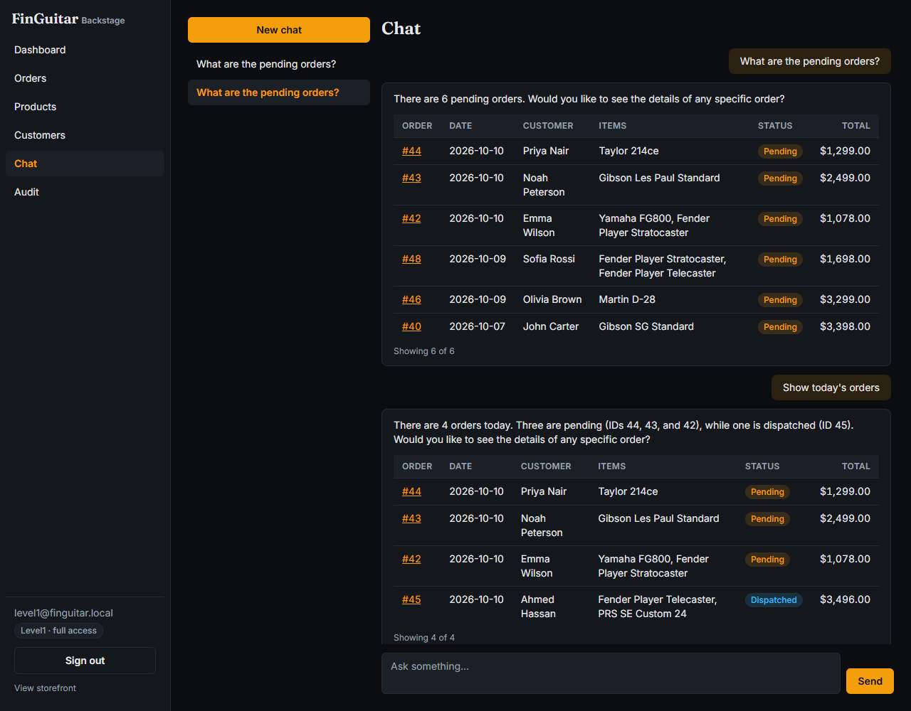
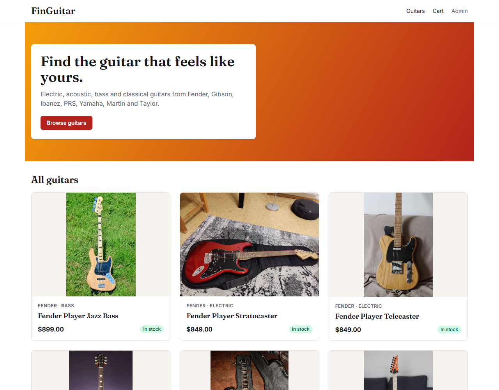
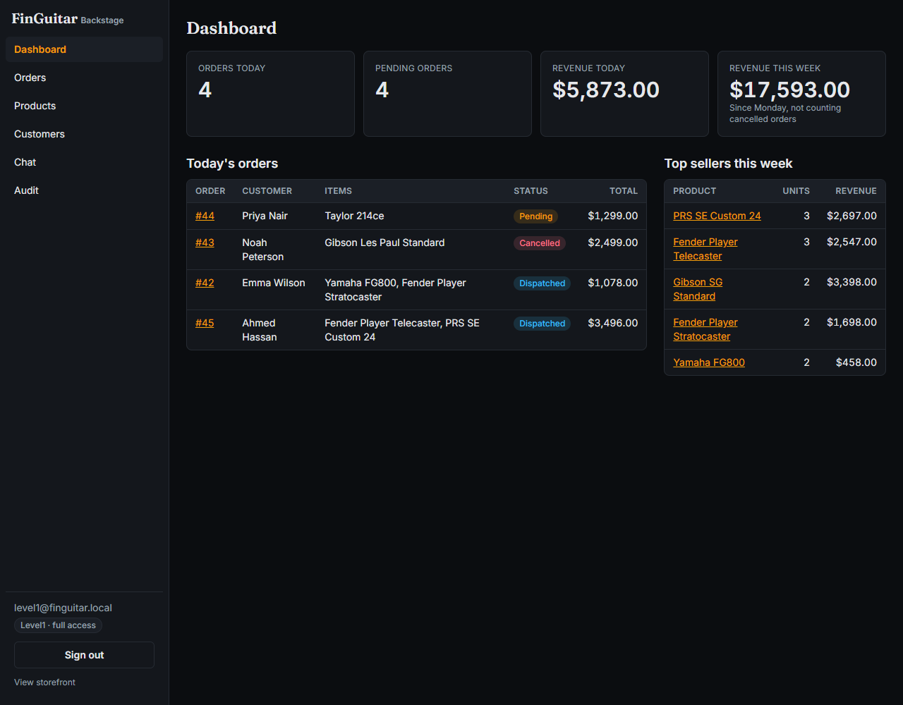
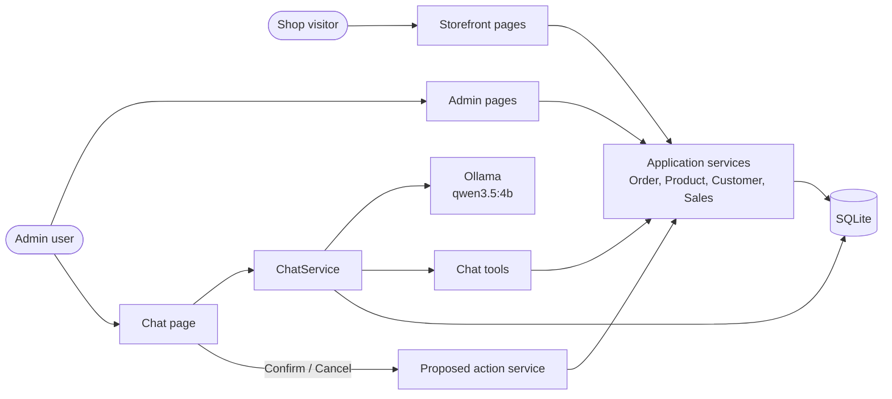
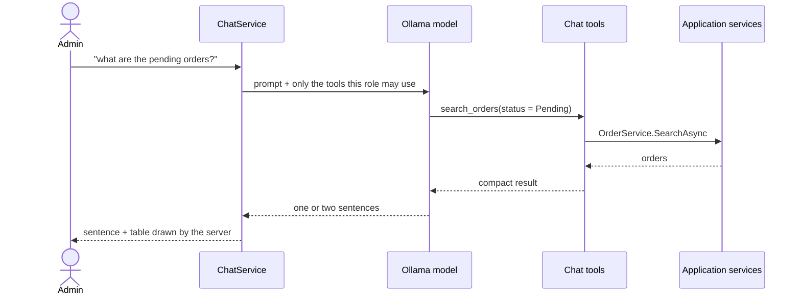
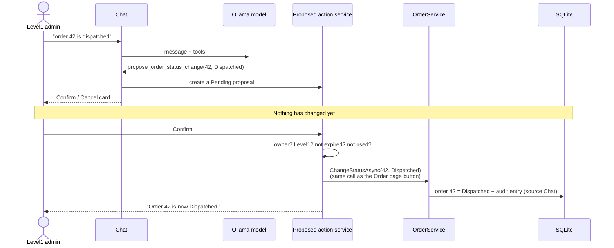
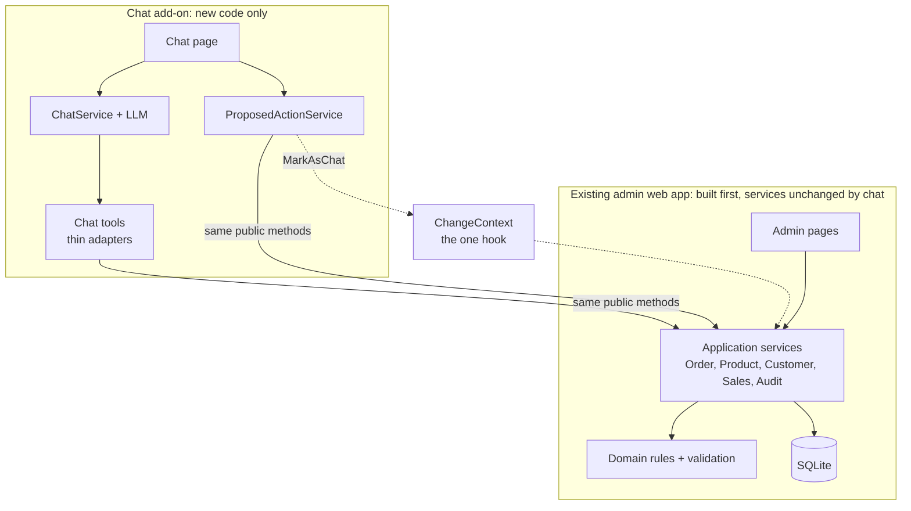
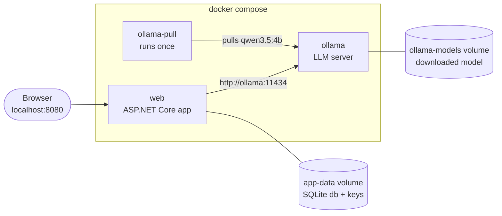

# FinGuitar: a sample admin chat that uses LLM tool calling to run real shop operations safely

## Why this exists

Admins of a web shop spend a lot of time clicking through filters to answer simple questions ("which orders are pending?") and to make small changes ("order 42 is dispatched"). A chat box would be faster, but letting a language model change real data is risky: it can pick the wrong order, invent numbers, or act without being asked.

FinGuitar is a small guitar shop with an admin panel that shows how to add such a chat **safely**, and how little it takes to add it to an application that already exists. The model can only call a fixed set of typed tools. Every change needs a click on a Confirm button, risky changes need a second click, every change is written to an append-only audit log, and the roles of the signed-in user are enforced in the code that changes the data.

## What you can do



Sign in at `/Admin`, open **Chat**, and type. The assistant answers in a sentence, and the **server** draws the table or card from real data, so the model can never put a wrong number in a table.

| Ask | You get |
|---|---|
| What are the pending orders? | A table of pending orders (up to 20, with the total) |
| Show today's orders | Today's orders |
| Find the order John placed for a Les Paul last week | The details of that one order |
| Which guitars are low on stock? | A product table |
| How much revenue this week? | Revenue and order count, the same number as the dashboard |
| Order 42 is dispatched | A **Confirm / Cancel** card. Nothing changes until you press Confirm. |
| Cancel order 43 | A **critical action** card, then a second card that says it cannot be undone |

More in [the chat page](docs/features/04-chat-assistant.md). The shop and the admin panel work without the chat:

| The shop | The admin panel |
|---|---|
|  |  |

## How it works



The admin pages and the chat both call the same **application services**. The services hold the rules, the SQL, the role checks and the audit trail. The chat never talks to the shop tables directly.

A chat turn, in short:



The model only chooses a tool and fills in its arguments. The tool does the work and the page draws the result. See [the architecture page](docs/architecture.md) for more.

## How it stays safe

- **Roles are checked in the code that changes data.** The model is only offered the tools its user may use (Level2 gets read tools only), each tool checks the role again, and every service write method checks it a third time. Hiding a button is never the only protection.
- **Confirm before every write.** The assistant can only *propose* a change. The change happens when the admin clicks Confirm: by the person who asked, once, within 10 minutes.
- **A second confirmation for critical changes.** Cancelling an order, a price change of 20% or more, and setting stock to 0 need a second card written by the server. The server decides what is critical, never the model.
- **An append-only audit trail** records who changed what, old and new values, and whether it came from the admin panel or the chat. Chat entries quote the request. The database refuses to edit or delete entries.
- **The server draws the tables** from tool results. The model writes one or two sentences.
- **No text-to-SQL.** The model can only use nine typed tools with validated arguments. All SQL is written by developers and uses parameters.



For a critical change (here, cancelling) there is one more step:

```mermaid
sequenceDiagram
    actor Admin as Level1 admin
    participant PA as Proposed action service
    participant Svc as OrderService

    Admin->>PA: Confirm (first)
    PA-->>Admin: no data change; the server posts a final card:<br/>"Cancelling order 43 cannot be undone."
    Admin->>PA: "Yes, cancel order 43" (second)
    PA->>Svc: ChangeStatusAsync(43, Cancelled)
    PA-->>Admin: "Order 43 is now Cancelled." (audit: confirmed twice)
```

Pages: [Sign-in and roles](docs/features/02-sign-in-and-roles.md), [Confirm before write](docs/features/06-confirm-before-write.md), [Audit trail](docs/features/08-audit-trail.md).

## What it took to add the chat

This is the point of the sample. The admin web app was built first, as an ordinary app, and tagged `before-chat`. The chat was then added on top.



Each tool is a thin adapter over a method the admin pages already use:

| Chat tool or step | Existing method it calls | Admin page that uses the same method |
|---|---|---|
| `search_orders` | `OrderService.SearchAsync(OrderFilter, 1, 20)` | Orders list |
| `get_order_details` | `OrderService.GetDetailsAsync(id)` | Order page |
| `propose_order_status_change` | `OrderService.GetDetailsAsync` and the status rule | Order page (which buttons to show) |
| `search_products` | `ProductService.SearchAsync(ProductFilter, 1, 20)` | Products list |
| `propose_product_update` | `ProductService.GetAsync` and `ProductRules.Validate` | Product edit form |
| `search_customers` | `CustomerService.SearchAsync(text, 1, 20)` | Customers list |
| `get_customer_details` | `CustomerService.GetDetailsAsync(id)` | Customer page |
| `get_sales_summary` | `SalesService.GetSummaryAsync(from, to)` | Dashboard revenue |
| `get_top_products` | `SalesService.GetTopProductsAsync(from, to, count)` | Dashboard top sellers |
| Confirm: order status | `OrderService.ChangeStatusAsync(id, status)` | Order page buttons |
| Confirm: product update | `ProductService.UpdateAsync(id, price?, stock?)` | Product edit form |

**What changed in existing files** (from `git diff --stat before-chat -- src/` for files that existed before the chat):

@@SEAM@@

**What was added** (new files): @@NEW@@

No service, domain, or existing migration file changed. The audit trail was designed from the start to know where a change came from, so the chat only *uses* `ChangeContext.MarkAsChat`.

**To do the same in another app:** put your logic in services that your pages already use (rules, validation, role checks, audit). Wrap those services as typed tools, with the model only choosing a tool and its arguments. Add confirmation for every write, and a second confirmation for the risky ones. The "same path" tests prove the chat and the pages give the same results.

## Tech stack

| Part | Why |
|---|---|
| .NET 10, Razor Pages | One web project, thin pages, built-in sign-in and anti-forgery |
| Dapper + SQLite | Hand-written SQL, no ORM, a single database file that is easy to reset |
| Cookie authentication, `PasswordHasher` | Part of ASP.NET Core, so no extra package; roles `Level1` and `Level2` |
| Tailwind CSS v4 | Two custom themes (white shop, dark admin), built at build time, no CDN |
| Microsoft.Extensions.AI + OllamaSharp | A standard chat-client interface with automatic tool calling |
| `qwen3.5:4b` on Ollama | Small enough to run on a laptop, good at picking the right tool |
| Docker Compose | One command starts the app, Ollama, and the model download |

## Getting started

### Demo logins

| Role | Email | Password | Can do |
|---|---|---|---|
| Level1 | `level1@finguitar.local` | `Demo@Level1` | Everything: read, and change orders and products |
| Level2 | `level2@finguitar.local` | `Demo@Level2` | Read only |

These are demo-only passwords. They are public in this repository.

### Run with Docker

You only need [Docker](https://docs.docker.com/get-docker/).

```
git clone <this repository>
cd <folder>
docker compose up --build
```

Then open:

- the shop: <http://localhost:8080>
- the admin panel: <http://localhost:8080/Admin>

The first run downloads about 3 GB for the language model and may take several minutes. The shop and admin panel work straight away. The chat says "still downloading" until the download finishes. The database is created and filled with sample data on the first start.



Three services start: `ollama` (serves the model), `ollama-pull` (downloads the model once, then exits) and `web` (the app). The database and the model live in Docker volumes, so later starts download and seed nothing.

### What is in the sample data

15 guitars (a few low on stock, one out of stock), 10 customers, and 48 orders over the last 30 days. Orders 42, 43 and 44 are Pending. John Carter's only Les Paul order is on the Wednesday of last week (order 30). Dates are relative to the first start, so the "today" orders are only "today" on the first day. To replay the guided tour on a later day, reset the database (see the commands below).

### Useful commands

| Goal | Command |
|---|---|
| Start everything | `docker compose up --build` |
| Stop | `docker compose down` |
| Reset the database and start fresh | `docker compose down -v`, then `up` again (this also deletes the downloaded model) |
| Reset only the database (fresh dates) | `docker compose down`, then `docker volume rm <project>_app-data`, then `up` |
| Run the tests | `docker build --target test .` |
| View the app logs | `docker compose logs -f web` |

### Settings

- **Time zone:** set `TZ` so "today" matches yours: `TZ=Europe/London docker compose up`.
- **Port:** set `WEB_PORT` if 8080 is taken: `WEB_PORT=9090 docker compose up`.
- **GPU:** `docker compose -f docker-compose.yml -f docker-compose.gpu.yml up` gives Ollama an NVIDIA GPU.
- **Model and timeout:** `Ollama__Model` and `Ollama__TimeoutSeconds` in `docker-compose.yml` (the model to download is on the `ollama-pull` service).

### Run without Docker (for developers)

You need the .NET 10 SDK, Node 22 or newer, and a local Ollama with `ollama pull qwen3.5:4b`.

```
cd src/FinGuitar.Web
npm ci
npm run css:build
cd ../..
dotnet run --project src/FinGuitar.Web
```

The settings are in `src/FinGuitar.Web/appsettings.json` (`Ollama:Endpoint`, `Ollama:Model`, `Ollama:TimeoutSeconds`) and can be overridden with environment variables such as `Ollama__Model`.

### Troubleshooting

- **The chat says the model is still downloading:** the first `docker compose up` downloads about 3 GB. Watch it with `docker compose logs -f ollama-pull`.
- **The chat says the assistant is not available:** check that Ollama is running (`docker compose ps`).
- **The page has no styling (without Docker):** the CSS was not built. Run `npm ci && npm run css:build` in `src/FinGuitar.Web`.
- **Port already in use:** set `WEB_PORT`.
- **Slow answers:** on a CPU-only machine each answer can take 30 seconds or more, and the first one longer while the model loads. A GPU helps.
- **Anything else:** `docker compose logs -f web`.

## Try it

A guided tour. Start from a freshly seeded database (see the reset command above), sign in as `level1@finguitar.local`, open **Chat**, and type:

1. `What are the pending orders?` A table of pending orders.
2. `Show today's orders` Today's orders.
3. `Find the order John placed for a Les Paul last week` The one order (it has id 30).
4. `Order 42 is dispatched` A card. Press **Confirm**: "Order 42 is now Dispatched."
5. Find a Delivered order on the Orders page, then ask `Change order <id> to Pending`. The chat explains the rule and no card appears.
6. `Which guitars are low on stock?` A product table. Then `Set the stock of product 7 to 12` and confirm.
7. `How much revenue this week?` Compare it with the dashboard.
8. `Cancel order 43` Press **Confirm**, read the final card, then press **Yes, cancel order 43**. Next, `Cancel order 44` and press **Keep order** on the final card: nothing changes.
9. `Set the price of product 3 to 1250` (+25%: two confirmations). Then `Set the price of product 3 to 1050` (+5%: one).
10. Open **Audit**: the chat changes carry the **Chat** badge, the quote, and a **View in chat** link. Edit a product price on the Products page to see an **Admin panel** entry, and filter the source by Chat.

Then sign out and sign in as `level2@finguitar.local`: questions work, `Order 42 is dispatched` is refused politely, and the audit page shows the quote without a link. Stop Ollama (`docker compose stop ollama`) and send a message to see the "not available" message.

## Running the tests

```
docker build --target test .      # Docker only
dotnet test                       # with the .NET 10 SDK
```

The tests use a fresh in-memory SQLite database built from the same migration scripts the app uses, and a scripted fake model inside the real tool-calling client, so no Ollama is needed. They cover the rules (all 16 status pairs), search and paging, sales, sign-in and lockout, roles, the audit trail, the cart, the pages, proposals and critical actions, the tools, chat turns and errors, conversation privacy, and "same path" checks that show the chat and the admin pages give the same results.

## Project structure

```
FinGuitar.sln
src/FinGuitar.Web/
  Domain/      Plain classes and business rules (order status rules, product rules)
  Data/        Database access, migrations (SQL scripts), seed data
  Services/    Application services used by every page; sign-in, audit, cart
  Chat/        Everything the chat adds: service, tools, proposed actions, critical policy, prompt
  Pages/       Razor Pages: storefront, account, admin (and the chat page, with Shared/Chat partials)
  Styles/      Tailwind input and both themes
  wwwroot/     Fonts, product photos, built CSS, chat.js
tests/FinGuitar.Tests/   xUnit tests on an in-memory SQLite database
docs/                    Architecture, data access, UI styles, one page per feature, screenshots
Dockerfile, docker-compose.yml, docker-compose.gpu.yml
intent.md, spec.md, plan.md   What was asked for, the design, and the build plan
```

## Documentation

- [Architecture](docs/architecture.md), [Data access](docs/data-access.md), [UI styles](docs/ui-styles.md)
- Features: [1 Storefront](docs/features/01-storefront.md), [2 Sign-in and roles](docs/features/02-sign-in-and-roles.md), [3 Admin panel](docs/features/03-admin-panel.md), [4 Chat assistant](docs/features/04-chat-assistant.md), [5 Chat tools](docs/features/05-chat-tools.md), [6 Confirm before write](docs/features/06-confirm-before-write.md), [7 Chat history](docs/features/07-chat-history.md), [8 Audit trail](docs/features/08-audit-trail.md)
- What was asked for and decided: [intent.md](intent.md), [spec.md](spec.md), [plan.md](plan.md)

## Acceptance results

@@ACCEPT@@

## Limitations and non-goals

Not in this sample: checkout and payments, customer accounts, shipping, text-to-SQL, streaming replies, other languages, production hosting or HTTPS, cloud models or switching providers, user-management screens, password reset, two-factor sign-in, editing or deleting conversations, seeing another user's conversations, product photo upload, and auditing anything other than shop data.

Known weaknesses of a small model (`qwen3.5:4b`):

@@WEAK@@

## Credits

Product photos come from Wikimedia Commons under licences that allow redistribution. Each file, its source, author and licence are listed in [`CREDITS.md`](src/FinGuitar.Web/wwwroot/images/products/CREDITS.md). Fonts: Fraunces and Inter (SIL Open Font License).
