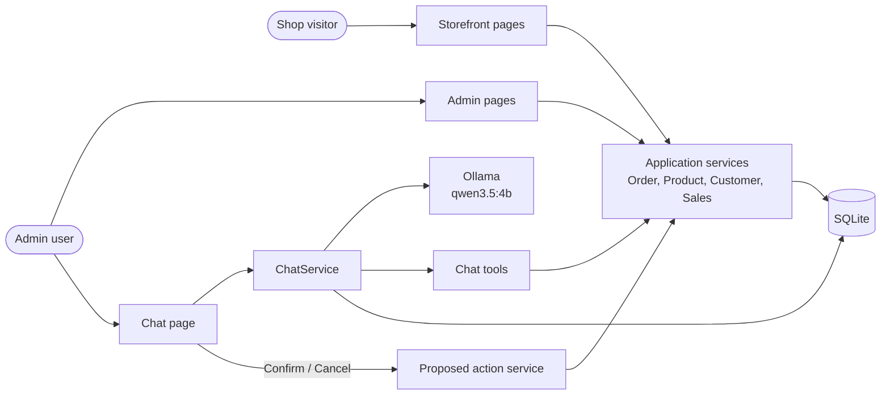
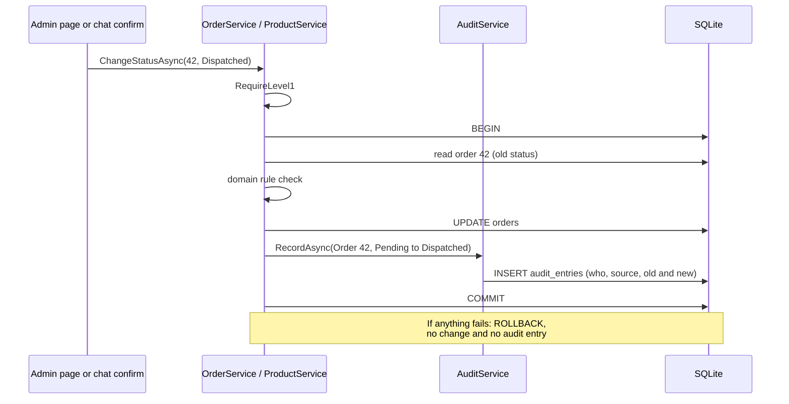
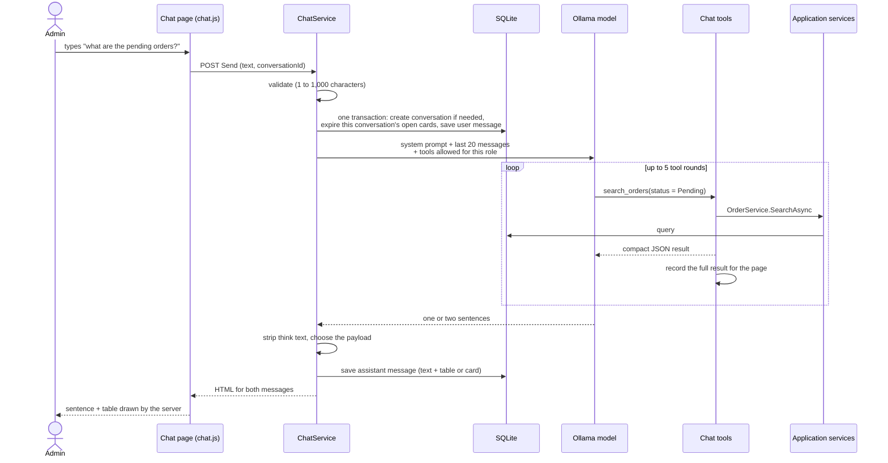
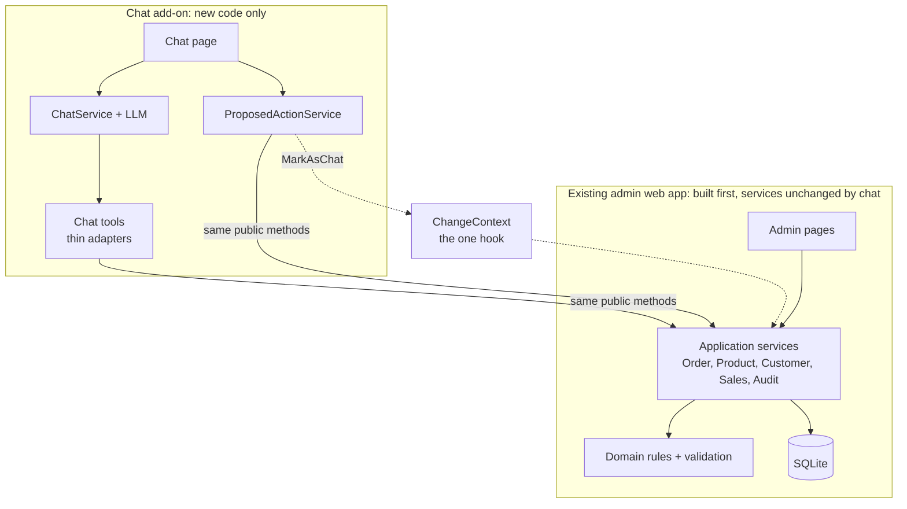
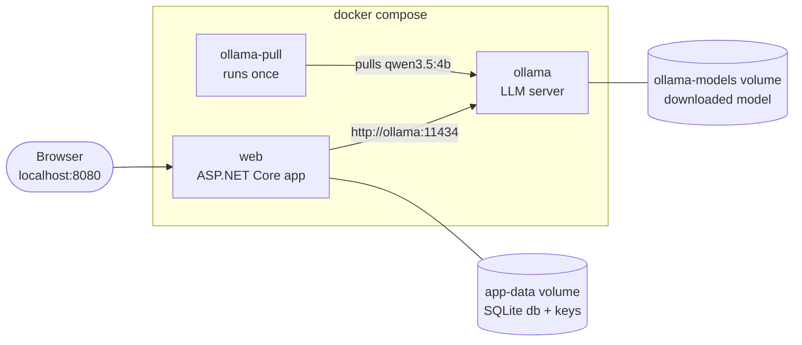
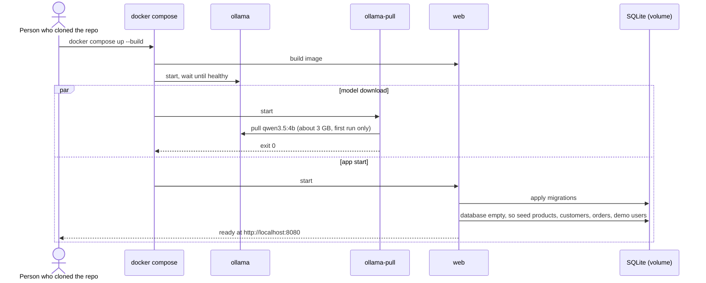

# Architecture

FinGuitar is one ASP.NET Core Razor Pages project plus one test project. The admin web app was built first, as an ordinary application with no chat code. The chat was then added as a layer that calls the same application services the admin pages call.

## Components

The chat never talks to the shop tables directly. Every read and write goes through the same application services as the admin pages. Pages are thin: they read input, call a service, and show the result. Services own the rules, the SQL, the role checks, and the audit trail.

### Layers

| Folder | Job |
|---|---|
| `Domain/` | Plain classes and rules: `Order.ChangeStatus`, `OrderStatusRules`, `ProductRules`, exceptions |
| `Data/` | `Db` (opens connections), `DbMigrator`, `Migrations/*.sql`, `SeedData`, Dapper setup |
| `Services/` | `OrderService`, `ProductService`, `CustomerService`, `SalesService`, `AuditService`, `AuthService`, `CartService`, `CurrentUser`, `ChangeContext` |
| `Pages/` | Razor Pages: storefront, account, admin |
| `Chat/` | Everything the chat adds (see the chat pages) |

## A change and its audit entry

The role check comes first, then the change and the audit entry commit together or not at all. The source (Admin panel or Chat) comes from `ChangeContext`, so the method signatures do not change for the chat.

## A chat turn

The two halves of a turn are separate transactions because the model call sits between them. If the model fails, an error message is saved instead of a reply.

## How the chat is plugged in (the seam)

The chat is a layer on top of an app that was complete without it. It adds new files under `Chat/`, a migration for its own tables, a page, partials and a script. It changes only a handful of existing files:

| Existing file | Change |
|---|---|
| `Program.cs` | Register the model client, the chat services and the Ollama options |
| `FinGuitar.Web.csproj` | Add `Microsoft.Extensions.AI` and `OllamaSharp` |
| `appsettings.json` | Add the `Ollama` section |
| `Pages/Shared/_AdminLayout.cshtml` | Add the "Chat" menu item |
| `Pages/Admin/Audit/Index.cshtml` | Show the Chat badge, quote, owner-only link and "Confirmed twice" |

Everything else the chat needs it gets by calling the same service methods the admin pages call. The only hook is `ChangeContext.MarkAsChat`, which was part of the audit design from the start.

## Docker

| Service | Job |
|---|---|
| `ollama` | Serves the model. Pinned image `ollama/ollama:0.40.2`. Health check: `ollama list`. Its port is not published to the host. |
| `ollama-pull` | Runs `ollama pull qwen3.5:4b` once, then exits. |
| `web` | The app on port 8080. It waits only for `ollama` to be healthy, not for the download, so the shop and admin panel work at once. |

The model and the database live in named volumes, so later starts download and seed nothing. `docker compose down -v` removes both.

## Data model

See the ER diagram in [data-access.md](data-access.md).

## Spike findings (plan task 1.2, run 2026-10-10)

Throwaway console app against a local Ollama 0.40.2, `Microsoft.Extensions.AI` 10.10.0, `OllamaSharp` 5.5.0, two tools (`search_orders`, `propose_order_status_change`) through `ChatClientBuilder(...).UseFunctionInvocation()`.

1. **Model and image.** Tag `qwen3.5:4b` (id `d8b0f5e9760c`, 3.3 GB). Pin the Docker image `ollama/ollama:0.40.2` (tag verified to exist). The model supports thinking and defaults to it (`/api/show` reports `thinking.default = true`), so `think = false` must be sent explicitly.
2. **Tool selection: 10/10.** Right tool for "pending orders", "today's orders", "John's Les Paul order last week", "order 42 is dispatched", "cancel order 43", "which orders are dispatched?", "orders from Mary", "mark order 44 as delivered", "any cancelled orders?", "orders placed yesterday". Gate passed; model choice stands.
3. **`think = false`.** `ChatOptions.AdditionalProperties["think"] = false` works. No `<think>` text appeared in any reply. `ThinkStripper` stays as a defensive fallback.
4. **Dates.** With today's date and weekday in the system prompt, the model passed `yyyy-MM-dd` (e.g. "last week" became `2026-10-03` to `2026-10-10`, "yesterday" became `2026-10-09`). Note "last week" came back as a rolling 7 days, not the Monday-based week; the tool description for date ranges and the prompt must say which one is meant.
5. **Round limit (`MaximumIterationsPerRequest = 5`).** Does not throw and does not return pending tool calls. It returns normally with a final text-only message (11 messages in the test). Detect the limit by counting rounds in `ToolResultLog` (P7).
6. **Errors.** Model not pulled: `HttpRequestException`, "Response status code does not indicate success: 404 (Not Found)". Ollama down: `HttpRequestException`, "No connection could be made because the target machine actively refused it". Both are `HttpRequestException`, so tell them apart by `StatusCode == 404` (D21) versus no status code (unreachable, FR-C13). Timeout is not covered here; use the `CancellationToken` and catch `OperationCanceledException`.
7. **Omitted arguments** arrive as empty strings, not `null` (`customerName=`, `dateFrom=`). Tool argument parsing must treat empty and whitespace as "not provided".
8. **Latency.** About 25-40 s per turn on this machine's CPU (each turn is one tool round plus the answer). The default `TimeoutSeconds` of 120 leaves room for two tool rounds; the UI must show the thinking indicator the whole time.
