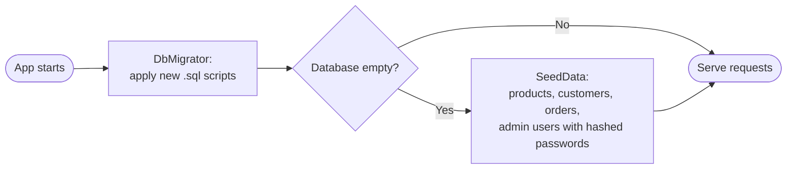
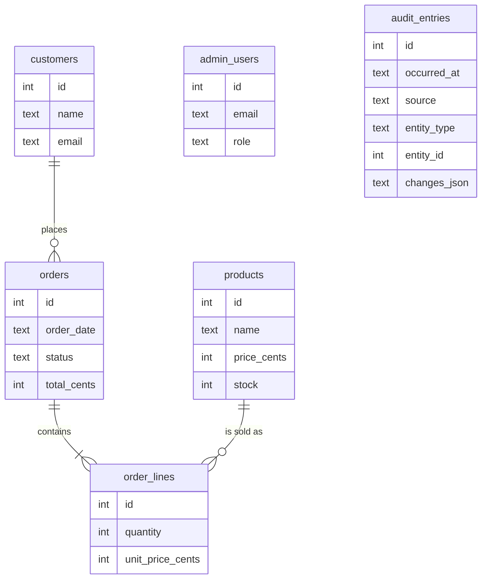

# Data access

FinGuitar keeps its data in SQLite and reads and writes it with **Dapper**, a thin helper that maps SQL results to C# objects. There is no ORM. Each service owns the SQL it needs, next to the logic that uses it.

## How a query runs

1. A service calls `Db.OpenAsync()`. It returns an open connection with foreign keys on and a 5-second busy timeout.
2. The service runs hand-written SQL with parameters (`@name`). Input is never joined into SQL text.
3. Writes that touch more than one row run in one transaction. A data change and its audit entry always share a transaction.
4. The connection is disposed when the method ends.

Rules for SQL in this project:

- Parameters only. Search filters build the `WHERE` clause from fixed text fragments. Only the parameter values come from input.
- Explicit column lists, no `SELECT *`.
- Text search uses `LIKE @term ESCAPE '\'`. `Sql.Contains` escapes `%`, `_` and `\` in what the user typed, so those characters match themselves.

## Money, dates, enums and ids in SQLite

SQLite has no decimal or date type, so the project fixes a format for each:

| Kind | Stored as | Notes |
|---|---|---|
| Money | Whole cents in an `INTEGER` column (`price_cents`, `total_cents`, `unit_price_cents`) | `Money.ToCents` and `Money.FromCents` convert at the service boundary. Pages and chat tools only see `decimal`. Sums and sorting run in SQL. |
| Dates | `TEXT` as `yyyy-MM-dd HH:mm:ss` | One Dapper type handler writes and reads it, so the format never depends on driver defaults. Text order equals time order. Date ranges use `>= from AND < toExclusive`. |
| Enums | `TEXT` (`Pending`, `Level1`, …) | A `CHECK` constraint lists the valid values. |
| Guids | `TEXT` | Used for chat proposed-action ids. |

All of this is set up in one place, `Data/DapperSetup.cs`. That file also turns on snake_case matching (`order_date` becomes `OrderDate`) and removes Dapper's built-in `DateTime` and `Guid` mappings, because those would otherwise override the type handlers when sending parameters.

## Migrations

Schema changes are numbered `.sql` scripts in `Data/Migrations/`, embedded in the assembly (a wildcard in the `.csproj` picks up new files, so adding a script means adding a file).

To add a migration:

1. Create `Data/Migrations/NNNN_short_name.sql` with the next number.
2. Write plain SQL. Do **not** edit an older script once it is committed.
3. Start the app, or run the tests. The migrator applies it.

`DbMigrator` creates a `schema_version` table, then runs each script that has not been applied, in number order. Each script runs in its own transaction together with its `schema_version` row. It also switches the database to WAL mode once.

## Start-up: migrate, then seed

On the very first start the database is created, migrated, and filled with sample data. On later starts nothing is re-seeded. Seed dates are relative to that first start, and the seed is not written to the audit log.

## The data model

`audit_entries` is deliberately not linked by foreign keys: an entry must stay readable even if the thing it describes changes. Two database triggers refuse any `UPDATE` or `DELETE` on it, so the log is append-only. The chat feature adds three more tables in a later migration (`chat_conversations`, `chat_messages`, `proposed_actions`).

## Where in the code

- `Data/Db.cs`, `Data/DapperSetup.cs`, `Data/DbMigrator.cs`, `Data/Money.cs`, `Data/Sql.cs`
- `Data/Migrations/0001_initial.sql`, `Data/SeedData.cs`

## How it is tested

Every test builds a fresh in-memory SQLite database with the same migration scripts the app uses (`TestDb`), so each query is checked against the real schema. See `MigrationTests`, `SeedDataTests` and the search tests.
