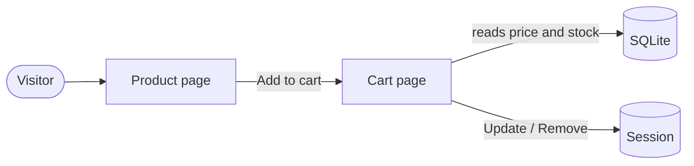

# Storefront

## What it does

The storefront is the public guitar shop. Visitors browse all guitars, open a product page with a larger photo, and keep a cart for the visit. There is no checkout: this is a demo.

## Who can use it

- **Visitors** (no sign-in): everything on this page.
- **Admins** use the separate admin panel. A small "Admin" link in the top bar leads there.

## How to use it

1. Open the home page. Every guitar shows its photo, name, brand, category, price and "In stock" or "Out of stock".
2. Click a guitar to see a larger photo.
3. Press **Add to cart**. The button is disabled for products that are out of stock.
4. Open **Cart** in the top bar. Change a quantity and press **Update**, or press **Remove**. The cart shows each line total and a grand total, and says "Checkout is not part of this demo".

## How it works

The cart lives in the visitor's session (a small cookie plus server memory), stored as "product id and quantity". Prices and stock are never stored in the cart: they are read from the database every time the cart is shown, so a price change is visible at once.

The visitor adds a product on the product page. The cart page keeps only the product ids and quantities in the session and looks up the rest in the database.

## Rules and limits

- A quantity is always between 1 and the product's stock.
- An out-of-stock product cannot be added.
- If a product sells out or disappears while it is in a cart, it quietly drops out of the cart.
- A product with no photo shows a neutral placeholder.
- Photos are lazy-loaded with a fixed shape, so the page does not jump while they load.

## When things go wrong

- Adding an out-of-stock product shows a notice on the cart page ("… is out of stock.").
- An unknown product address shows a "Not found" page.

## Where in the code

- `Pages/Index.cshtml`, `Pages/Products/Details.cshtml`, `Pages/Cart.cshtml`
- `Services/CartService.cs`, `Pages/Shared/_StoreLayout.cshtml`

## How it is tested

`CartTests` cover add, update, remove, totals, the quantity limits, out-of-stock products, prices read from the database, and a full add-to-cart run through the real pages. Acceptance scenario 14 (look and feel on phone and desktop) is checked by hand.
