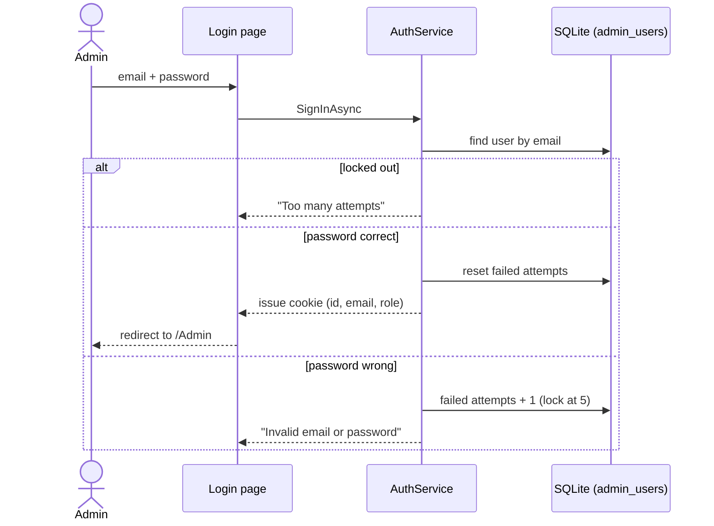
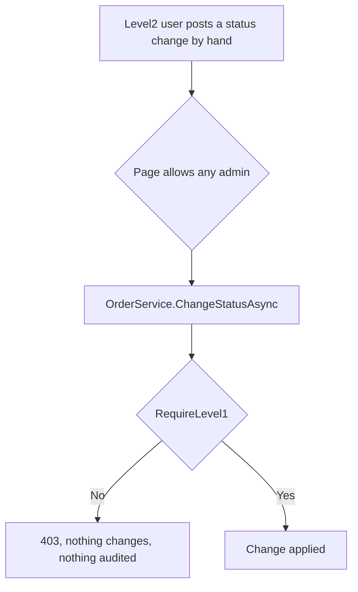

# Sign-in and roles

## What it does

Admins sign in with an email and password. Their role decides what they can do: **Level1** can read and change data, **Level2** can only read. The role is checked in the code that changes the data, not only on the screen.

## Who can use it

| Role | Demo login | Can do |
|---|---|---|
| Level1 | `level1@finguitar.local` / `Demo@Level1` | Everything: read, change order status, create and edit products |
| Level2 | `level2@finguitar.local` / `Demo@Level2` | Read only |

These passwords are demo-only and public. There are no screens to add users or reset passwords: the two users are created when the database is first filled.

## How to use it

1. Open `/Admin` (or press the Admin link on the storefront). You are sent to the sign-in page.
2. Enter an email and password. The page also lists the demo logins.
3. To leave, press **Sign out** in the sidebar. Signing out is a form post, so a link or an image cannot sign you out by accident.

## How it works

Sign-in uses the standard ASP.NET Core cookie. The cookie is HttpOnly, `SameSite=Lax`, and lasts 8 hours, renewed while you are active. It carries your id, email and role. Passwords are stored only as salted hashes made with ASP.NET Core's `PasswordHasher`.

Where the role is checked:

1. **Pages:** everything under `/Admin` needs Level1 or Level2. The product create and edit pages need Level1.
2. **Buttons:** Level2 users do not see the change buttons.
3. **Services:** every write method starts with `RequireLevel1()`. This is the check that really counts. A Level2 user who posts a form by hand is refused with a 403 page, and nothing changes.

## Rules and limits

- A wrong email and a wrong password give the same message: "Invalid email or password."
- After 5 wrong passwords in a row the account is locked for 5 minutes, even for the right password. A successful sign-in resets the count.
- **Accepted trade-off:** the lockout message ("Too many attempts") appears only for an account that exists, so it reveals that an email is registered. This is accepted because the demo users are public.
- The sign-in page only redirects to addresses on this site.

## When things go wrong

- Wrong details: "Invalid email or password."
- Locked: "Too many attempts. Try again in a few minutes."
- A Level2 user attempting a change: a "You do not have permission" page (HTTP 403).
- Visiting `/Admin` signed out: redirected to the sign-in page.

## Where in the code

- `Services/AuthService.cs`, `Services/CurrentUser.cs`, `Services/ForbiddenExceptionFilter.cs`
- `Pages/Account/Login`, `Logout`, `AccessDenied`; policies in `Program.cs`

## How it is tested

`AuthServiceTests` (claims, same message, lockout after 5, unlock after 5 minutes with a fake clock, reset on success). `RbacServiceTests` (Level2 refused on every write, nothing changed or audited). `AdminPageTests` (anonymous users redirected, Logout refuses GET, a Level2 direct post gets 403). Acceptance scenarios 6 and 15.
