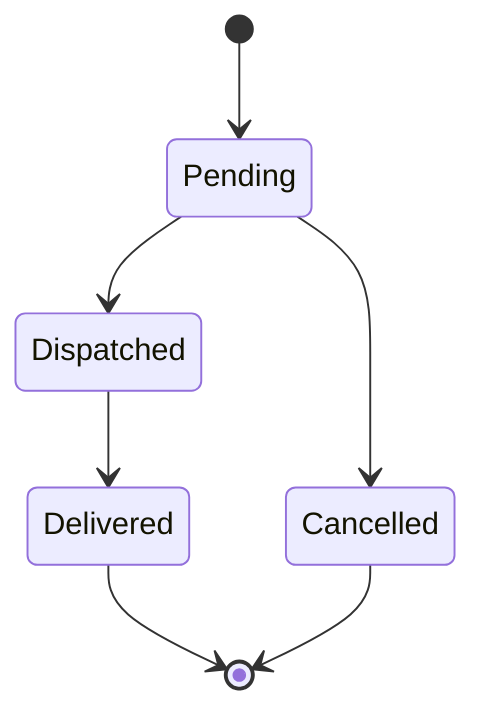

# Admin panel

## What it does

The admin panel is where shop staff run the shop: a dashboard of today's numbers, the orders list and order pages, the products list with photos, and a read-only customer list. It is an ordinary web application with no chat code in it. (The chat is added on top later and calls the same code.)

## Who can use it

- **Level2**: can look at everything.
- **Level1**: can also change an order's status, and create or edit products (price and stock).

## How to use it

1. **Dashboard** (`/Admin`): orders today, pending orders, revenue today, revenue this week, today's orders, and the top 5 sellers this week.
2. **Orders**: filter by order id, status, date from/to, customer name, product name or total range. Twenty-five orders per page. Open an order to see the customer, items and history.
3. **Change an order's status** (Level1): on the order page press the button for the next step. **Cancel order** asks first: a panel says "Cancelling order 42 cannot be undone", with **Yes, cancel order 42** and **Keep order**.
4. **Products**: search by name, brand or category, or tick "Low stock only". Level1 can press **New product** or **Edit** to change price and stock.
5. **Customers**: search by name, email or phone, and open a customer to see their order history.

## How it works

Each page is thin. It reads filters from the address, calls an application service, and shows the result. The services own the rules and the SQL.

Order status can only move along these steps. Everything else is refused.

A new order starts as Pending. It can be dispatched and then delivered, or cancelled while it is still pending. Delivered and Cancelled orders are final.

**Revenue** adds up the totals of orders that are not Cancelled, by order date. "This week" runs from Monday 00:00 to now, in the server's local time. The dashboard and the chat use the same calculation.

## Rules and limits

- Status changes follow the diagram above. A refused change says, for example, "Order 17 is Delivered and cannot be changed to Pending."
- Price must be above 0 and at most 100,000. Stock must be from 0 to 10,000. A low-stock product has 3 or fewer.
- Saving a product with no change is refused: "No change: Product 7 already has that price and stock."
- Cancelled orders count toward neither revenue nor top sellers.
- New products get a placeholder photo. Photo upload is not part of the demo.
- Searches treat `%`, `_` and `\` as ordinary characters.

## When things go wrong

- A rule or validation message appears above the form or next to the field. Nothing is saved.
- A page for an order, product or customer that does not exist shows "Not found".
- A Level2 user who tries to change data sees "You do not have permission".

## Where in the code

- Pages: `Pages/Admin/Index`, `Orders/*`, `Products/*`, `Customers/*`
- Services: `Services/OrderService.cs`, `ProductService.cs`, `CustomerService.cs`, `SalesService.cs`
- Rules: `Domain/Order.cs` (`OrderStatusRules`), `Domain/Product.cs` (`ProductRules`)

## How it is tested

`OrderSearchTests` and `ProductSearchTests` (each filter, paging, wildcard escaping), `SalesServiceTests` (cancelled orders, the Monday boundary, dashboard equals summary), `OrderStatusRulesTests` (all 16 pairs), `ProductRulesTests`, and `AdminPageTests` (the cancel panel, allowed buttons, create and edit). Acceptance scenarios 1, 2, 5, 7 and 8.
