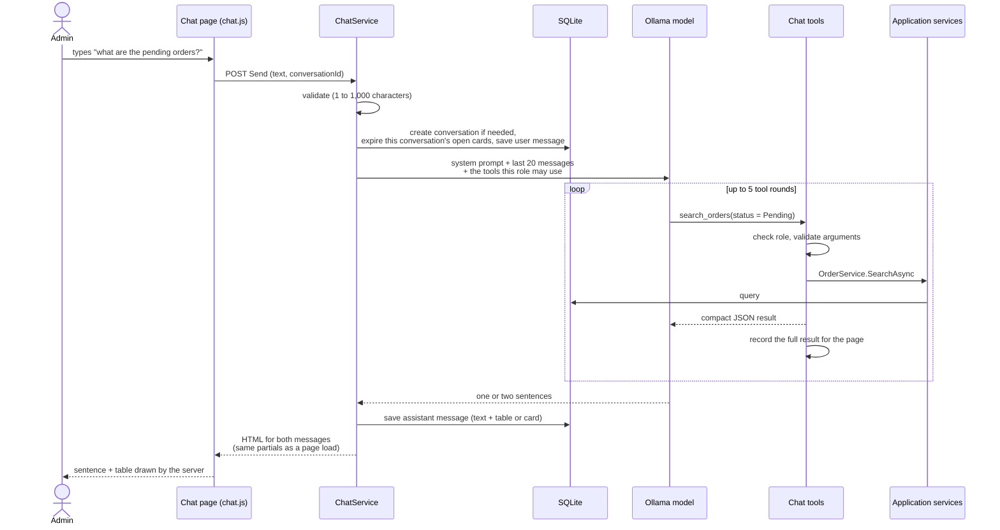
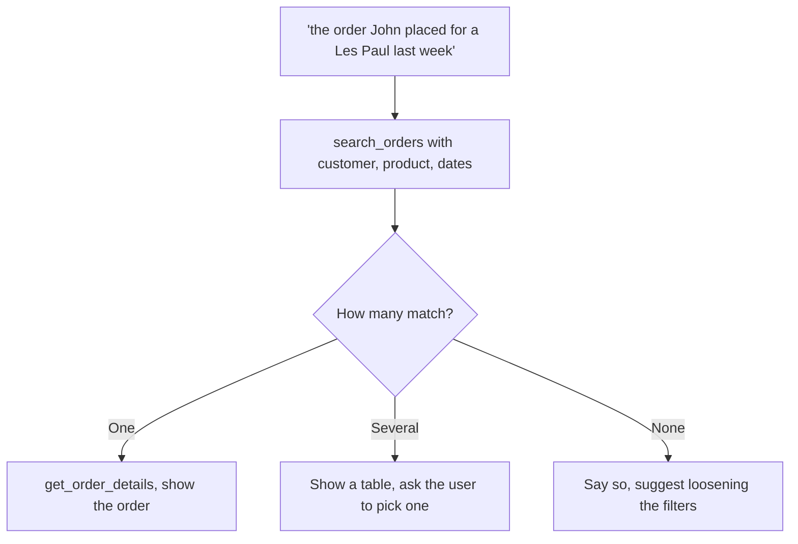

# Chat assistant

## What it does

The chat lets an admin ask questions in plain English ("what are the pending orders?") and ask for changes ("order 42 is dispatched"). The answer is a short sentence from a language model plus a table or card **drawn by the server** from real data. The model never writes the table, so a wrong number in its sentence can never appear in the table.

## Who can use it

- **Level1**: can ask questions and ask for changes (every change still needs a click on Confirm, see [06](06-confirm-before-write.md)).
- **Level2**: can ask questions. If they ask for a change, the assistant says they do not have permission, and the change tools are not even offered to the model.

## How to use it

1. Open **Chat** in the sidebar and type in the box at the bottom. Press Enter to send (Shift+Enter for a new line). Messages can be up to 1,000 characters.
2. While the assistant works you see "thinking" dots. There is one reply per message, with no streaming.
3. Try these:

| Ask | You get |
|---|---|
| What are the pending orders? | A table of pending orders |
| Show today's orders | A table of today's orders |
| Find the order John placed for a Les Paul last week | The details of that one order |
| Which guitars are low on stock? | A product table |
| How much revenue this week? | Revenue and order count (the same number as the dashboard) |
| Top 3 sellers this month | A table of the best-selling products |
| Order 42 is dispatched | A confirmation card |

Table rows link to the matching admin page. **New chat** starts a fresh conversation; the list on the left shows your earlier ones.

## How it works

The model is given a short list of tools, one per question type. It chooses a tool and its arguments. The tool does the work through the same services the admin pages use and gives the model a compact answer. The page shows the full result as a table. The system prompt gives the model today's date and weekday, the user's role, and the rules "answer only from tool results" and "never say a change is done until it is confirmed".

**Which table is shown.** If the turn created a proposal, the proposal card is shown. Otherwise the result of the **last successful** tool call is shown. If there was none, there is no table. So "search, then get details" shows the details.

**Finding an order from a description.** The model searches with the filters it can fill in (customer, product, dates, status):

**What the model sees from earlier turns.** The last 20 messages. Tables are summarised in one line (for example `[Shown: orders 12, 15, 19]`) so "the second one" can be understood. Error messages are not sent, so a past outage does not teach the model to refuse.

## Rules and limits

- At most 20 rows per table. If more match, the table says "Showing 20 of 37".
- Dates are always `yyyy-MM-dd`. Weeks start on Monday. The prompt tells the model what "this week", "last week" and "yesterday" mean.
- One model call, including all tool rounds, has a timeout (120 seconds, 180 in Docker) and at most 5 tool rounds.
- The assistant never changes data by itself. A change always goes through a confirmation card.
- Text from the model is shown as plain text, never as HTML or markdown.
- There is no text-to-SQL. The model can only use the typed tools (see [05](05-chat-tools.md)).
- A small model can still pick a wrong tool or misread a date. The table is always correct for what was actually asked of the tool, so check the filters in the sentence.

## When things go wrong

- **The model service is not reachable or too slow:** "The assistant is not available right now. Check that the language model service is running and configured."
- **Model still downloading:** "The assistant is still downloading its model. Try again in a few minutes."
- **Too many tool rounds:** "I couldn't finish that. Try asking more specifically."
- **Anything else:** "Something went wrong. Please try again."
- An empty message or one over 1,000 characters is refused with a message under the box.

These errors are saved in the conversation and the rest of the app keeps working. See [07](07-chat-history.md).

## Where in the code

- `Chat/ChatService.cs`, `ChatPrompt.cs`, `ThinkStripper.cs`, `ChatPayloads.cs`
- `Pages/Admin/Chat/Index`, `Pages/Shared/Chat/*` partials, `wwwroot/js/chat.js`

## How it is tested

`ChatTurnTests` (a scripted fake model inside the real tool-calling client: table choice, saved messages, history shaping, the three error cases, the round limit, message limits, think-text removal), `ConversationTests` (the real pages), `ThinkStripperTests`. Acceptance scenarios 1, 2, 3, 9 and 10.
