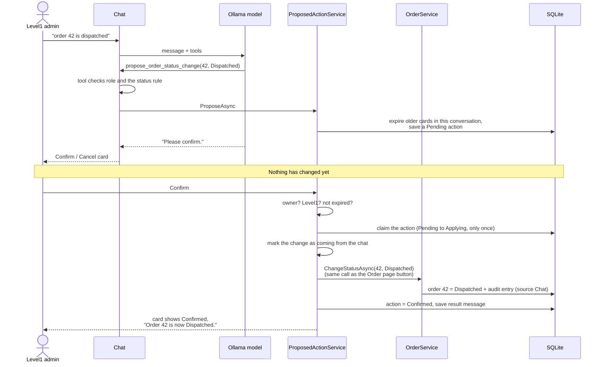
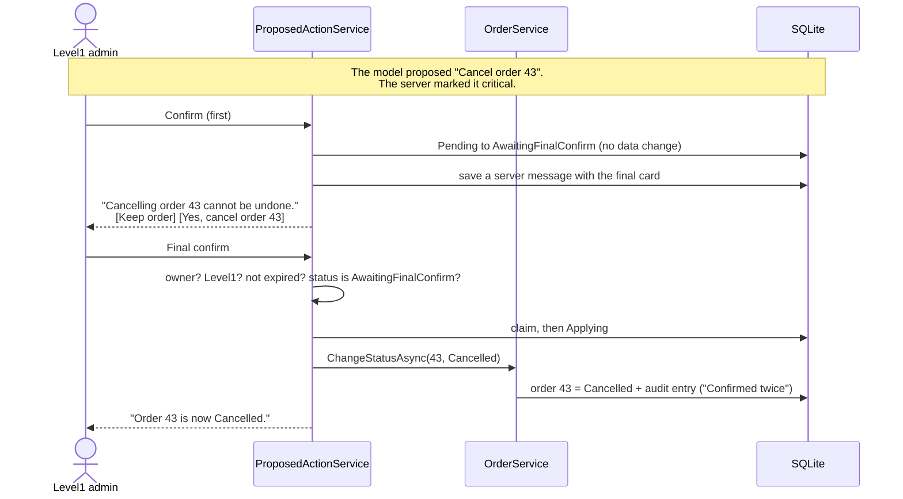
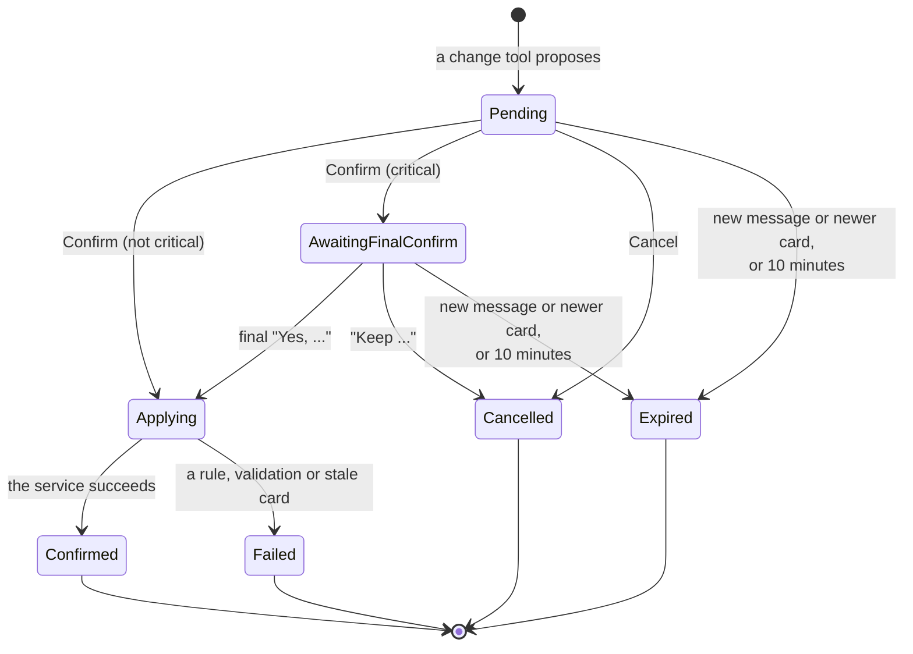

# Confirm before write

## What it does

The assistant can never change data on its own. When an admin asks for a change, the assistant creates a **proposal** and the page shows a card with **Confirm** and **Cancel** buttons. Nothing changes until the admin clicks Confirm. Risky changes need a **second confirmation**.

## Who can use it

Only **Level1**. A Level2 user is never offered the change tools. The person who asked is the only one who can confirm their own card, even if another Level1 admin guesses its address.

## How to use it

1. Ask for a change: "order 42 is dispatched" or "set the stock of product 7 to 12".
2. Read the card, for example **Change order 42 from Pending to Dispatched**.
3. Press **Confirm**. A message such as "Order 42 is now Dispatched." is added to the conversation. (The server writes it, not the model.)
4. Or press **Cancel**. Nothing changes.

Use the buttons: typing "yes" does not confirm anything.

### Critical changes

Three kinds of change are **critical**:

- cancelling an order
- changing a price by 20% or more (up or down)
- setting stock to 0

For these the first card says **Critical action**. After the first Confirm nothing changes yet: the server adds a final card that spells out the result, for example "Cancelling order 43 cannot be undone. The customer's order will be closed." with **Yes, cancel order 43** and **Keep order**. Only the Yes button makes the change. On this card the safe button is on the left and the danger button on the right (the reverse of the first card), and the danger button stays disabled for the first second, so a double click cannot confirm both steps.

## How it works

The confirmation applies the change by calling the **same service method the admin page calls**, so the same rules, validation and audit entry apply.

For a critical change there is one more step:

The life of a proposal:

**Who decides what is critical?** The server. `CriticalActionPolicy` runs when the proposal is created, and it is the only place those three rules and the 20% threshold are written. The model cannot talk its way around it, and the final card is written by the server.

## Rules and limits

- A card is **single use**: a second click does nothing (a notice says it was already used).
- A card **expires** when the admin sends another message in the same conversation, when a newer card is made in the same conversation, or after 10 minutes. Cards in other conversations stay live. An expired card says "Expired. Ask again."
- Only the owner can confirm. Another user, even Level1, gets "not found".
- The final step is refused unless the first confirm has happened. A direct request to it does nothing.
- One proposal per chat turn.
- A proposal is checked against the rules **when it is made** and again when it is applied.
- A product card remembers the price and stock it showed. If the product changed in the meantime, the change is refused (see below).

## When things go wrong

- **The data changed after the card was shown** (for example someone already dispatched order 42): the card becomes **Failed**, with the reason ("Order 42 is Delivered and cannot be changed to Dispatched."), and nothing changes.
- **A product changed since the card was shown:** "Product 7 changed since this was proposed. Ask again."
- **The app stopped in the middle** (very rare): the card stays in an unknown state and says "Outcome unknown. Check the audit page." The audit page is always right, because a change and its audit entry are saved together or not at all.
- **Not permitted:** a Level2 user who somehow posts a confirm gets a 403.

## Where in the code

`Chat/ProposedActionService.cs`, `Chat/CriticalActionPolicy.cs`, the card partials `Pages/Shared/Chat/_ProposalCard`, `_FinalConfirmCard`, and `wwwroot/js/chat.js`.

## How it is tested

`CriticalActionPolicyTests` (19.9% versus 20%, up and down; stock 0 versus 1; cancel versus dispatch and deliver), `ProposedActionLifecycleTests` (owner only, single use, expiry, newer card, other conversations, failures, stale cards, both confirms, Keep, direct final confirm), `SamePathTests`, and `ConversationTests`. Acceptance scenarios 4, 6, 7, 17 and 18.
