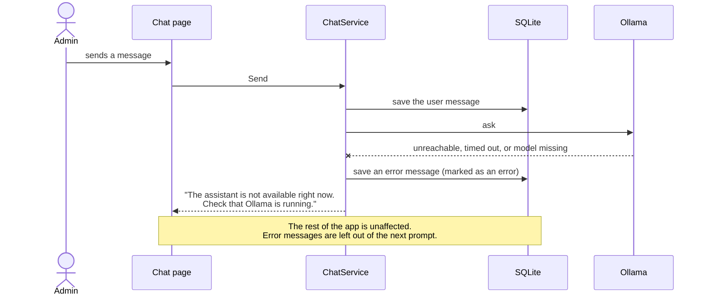

# Chat history

## What it does

Every conversation is saved, so you can leave the chat page and come back. Reopening a conversation shows the same messages, tables and cards as before. Cards show their **current** state, not the state they had when they were first drawn.

## Who can use it

Each admin sees only their own conversations. Conversations are private: even a Level1 admin cannot open someone else's, and the audit page shows another admin's chat request only as a quote, without a link.

## How to use it

1. Open **Chat**. The list on the left shows your conversations, newest first.
2. Click one to reopen it, or press **New chat** to start fresh. A new conversation is named after your first message (cut to 60 characters).
3. From the audit page, **View in chat** opens the conversation at the message that led to a change. (It is shown only on your own changes.)

Only the current conversation is sent to the model, so a new chat starts with a clean slate.

## How it works

Each message is stored with its role (you, the assistant, or a server-written result), its text, the table or card to draw (as JSON), whether it is an error, and the time. When a page loads, the server draws the saved messages with the same partials that draw a live reply.

Cards read their status from the database each time they are drawn. A confirmed card shows "Confirmed", an old one shows "Expired. Ask again.", and a card left mid-way shows "Outcome unknown. Check the audit page."

If the model cannot be reached, that is saved too, and the app keeps working:

## Rules and limits

- Conversations cannot be edited or deleted in this demo.
- The model sees the last 20 messages of the open conversation.
- Opening, sending to, or confirming a card in someone else's conversation gives a "not found" page.

## When things go wrong

- A conversation address that is not yours or does not exist gives "Not found".
- **Ollama stopped:** "The assistant is not available right now. Check that Ollama is running." Start Ollama and send again.
- **Model still downloading (first Docker start):** "The assistant is still downloading its model. Try again in a few minutes."

## Where in the code

`Chat/ChatStore.cs`, `Chat/ChatService.cs`, `Pages/Admin/Chat/Index`, `Data/Migrations/0002_chat.sql`.

## How it is tested

`ConversationTests` (own conversations only; 404 on open, Send, Confirm, Final confirm and Cancel; reload shows the table; sidebar), `ChatTurnTests` (saving, the error messages, the 60-character title, ownership). Acceptance scenarios 9, 10 and 13.
