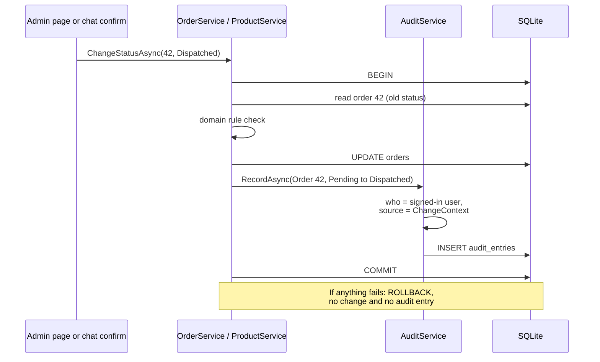

# Audit trail

## What it does

The audit trail is a permanent log of every change to shop data: an order's status, a new product, a product's price or stock. Each entry says who made the change, when, what changed (old and new values), and where it came from: the **Admin panel** or the **Chat**.

## Who can use it

Level1 and Level2 can both read the audit page. Nobody can edit or delete an entry.

## How to use it

1. Open **Audit** in the sidebar. Newest entries come first, 50 per page.
2. Filter by date range, source (All, Chat, Admin panel), user, and entity (type and id).
3. Press an entry's summary to see the old and new value of each field.
4. On an order or product page, the **History** section shows the latest entries and links to the audit page already filtered to that order or product.

### Changes made from the chat

A change that came from the chat shows a **Chat** badge (with a speech-bubble icon) and the original request quoted underneath, for example "order 42 is dispatched". Changes made on the admin pages show a neutral **Admin panel** badge. The source is always shown as text and an icon, never by colour alone.

- The admin who made the change also sees a **View in chat** link that opens the conversation at their request. Other admins see the quote but no link, because conversations are private.
- Changes that needed two confirmations (cancelling an order, a price change of 20% or more, stock set to 0) also show a **Confirmed twice** marker.
- Filtering the source by "Chat" shows only chat changes.

## How it works

The rule is: a change and its audit entry are written in the **same database transaction**, by the service that makes the change. So a change cannot exist without its entry, and an entry cannot exist without its change.

If a rule refuses the change, the transaction is rolled back and nothing is recorded.

Where a change came from is held in a small per-request object (`ChangeContext`). It says "Admin panel" unless the chat marks it otherwise before calling the normal service method. This means the service methods look the same for both origins.

## Rules and limits

- Only shop data is audited: order status changes, products created, product price or stock updated.
- Not audited: seeding, sign-in counters and lockouts, and the chat's own records.
- The log is **append-only**. The application has no code that edits or deletes entries, and two database triggers refuse any `UPDATE` or `DELETE` on the table.
- Each entry keeps the user's email and role as they were at the time, so it stays readable even if users change later.
- Times are the server's local time.

## When things go wrong

- With no matching entries the page says "No changes yet…".
- If a change fails, there is simply no entry. Use the audit page as the source of truth for what really changed.

## Where in the code

- `Services/AuditService.cs`, `Services/ChangeContext.cs`
- `Data/Migrations/0001_initial.sql` (table and triggers)
- `Pages/Admin/Audit/Index`, History sections on the order and product pages

## How it is tested

`AuditTests` (one entry per write path with the right source, user and field changes; chat origin fields; a failed rule leaves no entry and no change; filters and paging), `MigrationTests` (the triggers refuse update and delete), and `AdminPageTests`. Acceptance scenario 16.
