# Spec: FinGuitar admin chat

Author: Sanuja Ariyapperuma. Status: ready for implementation planning (2026-10-10, review Q&A resolved). Source: [intent.md](intent.md)

This spec turns the intent into testable requirements (part 1) and a design that meets them (part 2). Where the intent already decides something, this spec does not repeat the reasoning. It only states the decision.

---

# Part 1: Requirements

Requirement IDs are used by the design, the tests, and the acceptance mapping at the end.

## 1.1 Decisions made during requirements

These close points the intent left open.

| # | Topic | Decision |
|---|---|---|
| D1 | Conversations | A user can have many conversations. The chat page has a **New chat** button and a list of the user's past conversations. Only the current conversation is sent to the model. |
| D2 | Confirmation card lifetime | A card can be confirmed only while it is still pending. Expiry is **per conversation**: a pending card **expires** when the first of these happens: the user sends another chat message **in the same conversation**, a newer card is created **in the same conversation**, or 10 minutes pass. A user can have live cards in several conversations at once. An expired card shows "Expired. Ask again." Typing "yes" does not confirm a card: the card says "Use the buttons to confirm", and the system prompt tells the model the same. |
| D3 | Outcome of Confirm/Cancel | The server saves a result message in the conversation, for example "Order 42 is now Dispatched." There is no LLM call. The model sees that message as context on the next turn. |
| D4 | Model thinking output | Ask Ollama not to think (`think = false`). As a fallback, strip any `<think>…</think>` text before the reply is shown or saved. Thinking text is never stored. |
| D5 | Proposal validation | A write tool checks the domain rules **when it proposes**, as well as on confirm. If the change is not allowed, no card is created and the model gets the reason. |
| D6 | Failed confirm | If the domain rejects a change at confirm time (for example, the data changed after the card was shown), the action is marked `Failed` with the reason. Nothing changes. |
| D7 | Revenue definition | Revenue = the sum of order totals for orders that are **not Cancelled**, by order date. "This week" runs from Monday 00:00 to now, in server local time. |
| D8 | Time | "Today" and all order dates use server local time. The current time comes from an injected `TimeProvider`. In Docker, the container's time zone is set with the `TZ` variable in `docker-compose.yml`, so "today" matches the person running it. |
| D9 | How to run | Docker is the main way to run the app. After a clone, one command (`docker compose up --build`) starts the web app and Ollama, downloads the model, creates the database, and loads the seed data. The only thing a person needs installed is Docker. Running with `dotnet run` against a local Ollama still works for development. |
| D10 | Seed data | The database is created and filled with seed data automatically the first time the app starts, so it is never empty. No database file is committed to the repository, because seed dates are relative to the first start (SD-4) and a committed file would go stale. |
| D11 | Product photos | Each seeded product has a real photo, stored in the repository and served by the app. Every photo is under a licence that allows redistribution, and its source and licence are recorded. |
| D12 | Data access | **Dapper** over `Microsoft.Data.Sqlite`, with hand-written SQL. Schema changes are numbered `.sql` scripts applied at startup by a small migration runner. No ORM. |
| D13 | Admin sign-in | Standard ASP.NET Core **cookie authentication**. Users are kept in an `admin_users` table read with Dapper, and passwords are hashed with ASP.NET Core's built-in `PasswordHasher<T>`. An account is locked for 5 minutes after 5 failed attempts. ASP.NET Core Identity is not used, because its standard storage needs EF Core. The lockout message ("Too many attempts") reveals that an account exists; this is **accepted** for a local demo whose users are public, and the docs say so. |
| D14 | Look and feel | **Tailwind CSS** with a custom theme, not stock Tailwind looks. The storefront has a **white** background, and the admin panel, including the chat and the sign-in page, has a **dark** background. The CSS is built when the app is built, and no CDN is used at run time. |
| D15 | Audit trail | Every change an admin makes to **shop data** (an order status change, a product created, a product's price or stock updated) is written to an append-only audit log **in the same transaction as the change**, by the application service that makes the change. Seeding, sign-in bookkeeping (failed-attempt counters, lockout, password rehash), and the chat's own records (conversations, messages, proposed actions) are **not** audited. Each entry records where the change came from: the **admin panel** or the **chat**. Chat entries link back to the conversation, the user's request, and the confirmation. Both Level1 and Level2 can view the audit page. The audit schema, including the origin fields, is part of the admin app from the start (D17). |
| D16 | Critical chat actions | Some chat actions are **critical** and need a **second confirmation**: cancelling an order, changing a price by 20% or more, and setting stock to 0. After the first Confirm, the server (not the model) posts a second card that spells out the consequence. The change happens only after the second confirm. Non-critical actions still need one confirm. |
| D17 | Chat as an add-on | The point of the sample is to show that an **existing web application can gain a chat with minimal changes**. So the admin web app is designed and built first as an ordinary app, with **no chat code**. Its audit trail already records the origin of each change (Admin panel by default, with optional fields for a conversational origin), the way a real app's audit design would plan for more than one origin. The chat is a layer on top that **calls the same application service methods the admin pages call**. New service methods are allowed only when a page could use them as well, and chat-specific parameters are never added to shared methods. Every change the chat needs in the existing app is listed in 2.4.2 and counted in the README. |
| D18 | One change per turn | A chat turn can create at most one proposed action. A second `propose_*` call in the same turn returns `{ "error": "One change at a time. Ask the user to confirm this one first." }`, and the model tells the user. |
| D19 | Seed dates | Seed dates are computed from the first start. Fixed facts are anchored so they always hold on the first day: John's Les Paul order is on the **Wednesday of the previous Monday-based week**. Relative data goes stale after the first day ("today" orders become yesterday's). The README says the guided scenarios assume a fresh seed and shows how to reset only the database. |
| D20 | Cancelling on the admin page | Cancelling an order on the Order detail page also asks for confirmation: the Cancel button opens a confirmation panel ("Cancelling order 42 cannot be undone. [Yes, cancel order 42] [Keep order]"). It is part of the admin app before the chat. It is a UI step only; the server rules are the same as for any status change. |
| D21 | Starting before the model is ready | The `web` container waits only for Ollama to be healthy, not for the model download. The shop and admin panel work at once. Until the model is present, chat replies say "The assistant is still downloading its model. Try again in a few minutes." |
| D22 | Model round limit | If the model reaches the 5-tool-round limit (NFR-5) without a final answer, the reply is "I couldn't finish that. Try asking more specifically." (`IsError = true`), still showing the last successful tool payload if there is one. |

## 1.2 Functional requirements

### Storefront

- **FR-S1**: Visitors see a catalogue of all products with name, brand, category, price, a product photo, and "In stock" or "Out of stock". A product with no photo shows a neutral placeholder image.
- **FR-S2**: Visitors can open a product detail page, which shows the photo at a larger size.
- **FR-S3**: Visitors can add an in-stock product to a session cart. They can view the cart, change quantities, and remove lines. The cart shows line totals and a grand total.
- **FR-S4**: There is no checkout. The cart page says so.

### Authentication and roles

- **FR-A1**: Admins sign in with email and password on `/Account/Login` (D13). Everything under `/Admin` requires role `Level1` or `Level2`. Signing out is a POST.
- **FR-A2**: `Level1` can read and write. `Level2` can only read.
- **FR-A3**: Every write is checked for `Level1` by the application service that performs it, wherever the write comes from: an admin page, a chat confirm, or a direct POST.
- **FR-A4**: Two demo users are seeded: `level1@finguitar.local` (Level1, password `Demo@Level1`) and `level2@finguitar.local` (Level2, password `Demo@Level2`). The root README lists both logins (email, password, role, and what the role can do) in a table near the top of "Getting started". The passwords are demo-only and public, and the README says so.
- **FR-A5**: Passwords are stored only as salted hashes (`PasswordHasher<T>`). A wrong email and a wrong password give the same message: "Invalid email or password." After 5 failed attempts in a row, the account is locked for 5 minutes, and a successful sign-in resets the count.

### Admin panel

- **FR-P1 Dashboard**: shows today's orders, the count of pending orders, revenue today, revenue this week (D7), and the top 5 sellers this week. Cancelled orders count toward neither revenue nor top sellers (D7); both queries share one `status <> 'Cancelled'` fragment.
- **FR-P2 Orders**: a list with filters (order id, status, date from/to, customer name, product name, total range), paged at 25, and an order detail page. Level1 can change the status from the detail page, which shows only the allowed next statuses. Cancelling asks for confirmation first (D20).
- **FR-P3 Products**: a list with a small photo for each product and a low-stock filter. Level1 can create a product and edit its price and stock. New products get the placeholder image (photo upload is out of scope).
- **FR-P4 Customers**: a list and a detail page that shows order history. Read only.
- **FR-P5 Chat**: the chat page (FR-C*).
- **FR-P6 Audit**: the audit page (FR-AU*).

### Audit trail

- **FR-AU1**: Every successful change to shop data creates exactly one audit entry: an order status change, a product created, or a product's price or stock updated. If the change fails or is rolled back, no entry is written. Nothing else is audited (D15).
- **FR-AU2**: Each entry records: when; who (user id, plus email and role as they were at that time); the source (**Admin panel** or **Chat**); the entity (Order 42, Product 7); the action; a readable summary; and the field-level changes (field, old value, new value).
- **FR-AU3**: Chat entries also record the conversation, the proposed action, the user's chat message that led to the change (its id and its text), and whether the action was critical and confirmed twice.
- **FR-AU4**: The audit page (`/Admin/Audit`, Level1 and Level2) lists entries newest first, 50 per page. It has filters for date range, source (All / Chat / Admin panel), user, and entity (type and id).
- **FR-AU5**: The source is obvious at a glance. Chat entries show a distinct **Chat** badge with an icon and the original request quoted, for example "order 42 is dispatched". The user who made the change (the conversation's owner) also sees a "View in chat" link; other admins see the quote but no link, because conversations are private. Admin panel entries show an **Admin panel** badge. Critical chat entries also show a "Confirmed twice" marker.
- **FR-AU6**: The audit log is append-only. The app has no code path that edits or deletes entries, and the database refuses `UPDATE` and `DELETE` on the audit table.
- **FR-AU7**: The order and product detail pages show a short "History" section listing that entity's audit entries, with a link to the audit page filtered to it.

### Domain rules

- **FR-D1**: The only allowed order status changes are `Pending → Dispatched`, `Dispatched → Delivered`, and `Pending → Cancelled`. Any other change is rejected with a message such as "Order 17 is Delivered and cannot be changed to Pending."
- **FR-D2**: Price must be greater than 0 and at most 100,000. Stock must be between 0 and 10,000. A product update must change at least one value; an update that changes nothing is rejected with "No change: Product 7 already has that price and stock."
- **FR-D3**: Product low stock means stock ≤ 3.

### Chat

- **FR-C1**: An admin types a message and gets one reply. While waiting, the page shows "thinking…". There is no streaming.
- **FR-C2**: The model gets only the tools that the user's role allows (tool table in 2.6.2).
- **FR-C3**: When a tool returns data, the server renders it as a table or detail card **from the tool's structured result**. The model writes only the short text around it.
- **FR-C4**: Lists returned by tools hold at most 20 rows. If more rows match, the result says so ("showing 20 of 37").
- **FR-C5**: The system prompt contains today's date and weekday. The model must pass dates to tools as `yyyy-MM-dd`.
- **FR-C6**: The system prompt states the user's role. If a Level2 user asks for a change, the model replies that they do not have permission.
- **FR-C7**: To find an order from a description, the model calls `search_orders` with filters. One match: the reply shows its details. Several matches: the reply shows a table and asks the user to pick one. No matches: the reply says so and suggests loosening the filters.
- **FR-C8**: A write tool (`propose_order_status_change`, `propose_product_update`) never changes data. It validates the request (D5), creates a proposed action, and the reply shows a Confirm/Cancel card with a readable summary, such as "Change order 42 from Pending to Dispatched" or "Product 7 Fender Strat: stock 4 → 12".
- **FR-C9**: Confirm applies the change through the same application service the admin pages use. Cancel marks the action cancelled. In both cases a result message is added to the conversation (D3).
- **FR-C10**: A proposed action can be confirmed only by the user who created it, only once, only while pending and not expired (D2), and only if that user still holds Level1.
- **FR-C11**: Every message is saved with its role, text, structured payload (JSON), and timestamp. Reopening a conversation shows its tables and cards again. Cards show their current status (pending, awaiting final confirmation, applying, confirmed, cancelled, expired, or failed). A card left in `Applying` shows "Outcome unknown. Check the audit page." (2.6.5).
- **FR-C12**: Tool errors, invalid arguments, unknown ids, and domain rule violations go back to the model as a result such as `{ "error": "Order 999 not found" }`, and the model explains it. Tools do not throw for these cases.
- **FR-C13**: If the model service cannot be reached, rejects the request (for example a bad API key), or times out, the chat shows "The assistant is not available right now. Check that the language model service is running and configured." If Ollama is running but the model is not downloaded yet, the chat shows "The assistant is still downloading its model. Try again in a few minutes." (D21). The error is saved in the conversation, and the app keeps working.
- **FR-C14**: A chat message is limited to 1,000 characters. Empty messages are rejected.
- **FR-C15**: A proposed action is **critical** (D16) when it is any of these. The server decides this when it creates the proposal, and the rules live in one place.
  - an order status change to `Cancelled`
  - a price change where |new − old| / old ≥ 20%
  - a stock change to 0
- **FR-C16**: For a critical action, the first card says "Critical action" in its header. The first Confirm changes no data. Instead, the server adds a new chat message, written by the server and not by the model, with a final card. That card states the consequence, for example "Cancelling order 42 cannot be undone. The customer's order will be closed." It has a clearly labelled danger button, "Yes, cancel order 42", and a "Keep order" button. The change runs only when the danger button is clicked.
- **FR-C17**: The final confirm follows the same rules as the first (owner only, Level1, single use, not expired). It is accepted only after the first confirm. A direct POST to the final step without the first is refused. Sending a new chat message in the same conversation, or 10 minutes passing since the proposal, expires a card at either step (D2).
- **FR-C18**: A turn creates at most one proposed action (D18).
- **FR-C19**: If the model reaches the tool-round limit without a final answer, the reply is the D22 message, saved with `IsError = true`.

## 1.3 Non-functional requirements

- **NFR-1**: .NET 10 Razor Pages, a single web project plus one test project.
- **NFR-2**: Runs fully locally with SQLite (Dapper, SQL migration scripts, and seed data) and Ollama. Nothing calls a cloud service at run time. The model provider (`Ollama` by default, or any OpenAI-compatible API), endpoint, model name, API key, and timeout are set in the `Llm` section of `appsettings.json` and can be overridden with environment variables (`Llm__Provider`, `Llm__Endpoint`, `Llm__Model`, `Llm__ApiKey`, `Llm__TimeoutSeconds`). Nothing calls a cloud service unless the person chooses a hosted provider.
- **NFR-3**: Page models stay thin; application services own the logic. Use dependency injection, async I/O, and validation at the boundaries (forms, tool arguments, and chat endpoints). No speculative abstractions.
- **NFR-4**: Anti-forgery protection on every POST, including the chat AJAX calls (the token is sent in the `RequestVerificationToken` header).
- **NFR-5**: One model call, including all tool rounds, has a timeout (`Llm:TimeoutSeconds`: 120 by default, 180 in Docker) and at most 5 tool rounds (D22).
- **NFR-6**: There is no text-to-SQL. The model reaches data only through the typed tools. All SQL is written by developers and uses parameters. User or model input is never concatenated into SQL.
- **NFR-7**: Anyone who clones the repository can run the whole application with Docker alone: no .NET SDK, Ollama, or database install. `docker compose up --build` from the repository root is the only command needed (D9).
- **NFR-8**: Data survives container restarts. The SQLite database, Ollama models, and ASP.NET Core data-protection keys are kept in named Docker volumes. `docker compose down -v` resets everything, and the next start seeds a fresh database.
- **NFR-9**: The test suite can be run with Docker alone (`docker build --target test .`) as well as with `dotnet test`.
- **NFR-10**: The UI uses Tailwind CSS with the two themes in 2.7 (D14). Both themes meet WCAG 2.1 AA colour contrast (4.5:1 for text, 3:1 for focus rings and other non-text indicators) and show a visible keyboard focus ring. No text is placed on a gradient. Layouts work from 375 px phone width to desktop without horizontal scrolling. Animations respect `prefers-reduced-motion`.
- **NFR-11**: The chat reuses the admin app's code (D17). Chat tools and the confirm step may only call public methods of the application services that the admin pages also use, the domain rule classes those services use (`OrderStatusRules`, `ProductRules`), and chat-only code under `Chat/`. They never run their own SQL against shop tables (orders, products, customers, audit). The chat feature's own tables (conversations, messages, proposed actions) are the exception.

## 1.4 Documentation

Documentation is part of every feature, not a step at the end. A feature is not done until its documentation is written.

- **DOC-1**: The root `README.md` lets someone visiting the repository understand, without reading code, what the application is, what it shows (safe LLM tool calling for admin operations), how it works at a high level, and how to run it. Section 2.10.2 gives its outline.
- **DOC-2**: Each feature has its own page in `docs/features/`, written for a person who knows the business but not the code. It follows the template in 2.10.3: what the feature does, who can use it, how to use it, how it works, its rules and limits, where the code is, and how it is tested.
- **DOC-3**: When a scenario has more than one step, more than one actor, or a change of state, it is explained with a Mermaid diagram (` ```mermaid ` fenced block) as well as text. Examples: a chat turn, the confirm-before-write flow, order status changes, and the role checks. A diagram never replaces the text; the page must still make sense without it.
- **DOC-4**: `docs/architecture.md` explains the parts of the system and how a request moves through them, with a component diagram and the main sequence diagrams.
- **DOC-5**: Documentation is written in plain English: short sentences, terms defined on first use, and no unexplained jargon. Code names (classes, files) appear only in the "Where in the code" part of a page.
- **DOC-6**: Documentation is updated in the same change as the code it describes. If behaviour changes, its feature page changes too.
- **DOC-7**: The README shows the result of the manual acceptance run (all scenarios, 1 to 19, pass or fail, with notes) and includes screenshots of the storefront, the admin panel, and the chat (a table answer and a confirmation card).

## 1.5 Seed data

- **SD-1**: About 15 guitars across Fender, Gibson, Ibanez, PRS, Yamaha, Martin, and Taylor, in the categories Electric, Acoustic, Bass, and Classical. At least 3 are low on stock and 1 has stock 0. Product names include "Les Paul" and "Stratocaster". Each one has a photo (SD-5).
- **SD-2**: About 10 customers, including one named John.
- **SD-3**: At least 45 orders over the last 30 days, with ids set explicitly, covering every status. At least 3 are dated today. One is a Les Paul order by John dated the **Wednesday of the previous Monday-based week** (D19), and it is the only order matching John + Les Paul. Orders **42, 43, and 44** are Pending and used by the guided scenarios (42: dispatch, 43: cancel, 44: "Keep order"). At least one order is Delivered.
- **SD-4**: Seed dates are relative to the app's first start (D19). The app seeds on its first start, and only when the database is empty (D10). The seed covers products, customers, orders, and the two demo users. Relative facts such as "today's orders" hold on the day of the first start; after that, the README tells the reader to reset the database to replay the guided scenarios.
- **SD-5**: Product photos are JPEG files in `src/FinGuitar.Web/wwwroot/images/products/`, named after the product (for example `gibson-les-paul-standard.jpg`). Each is about 800 px wide and under 150 KB. They come from sources whose licence allows redistribution, such as Wikimedia Commons, Unsplash, or Pexels. `wwwroot/images/products/CREDITS.md` lists every file with its source URL, author, and licence, and the README links to it. A photo should show that type of guitar (for example, a single-cut electric for the Les Paul). It does not have to be the exact model.

## 1.6 Out of scope

These come from the intent's non-goals: checkout, payments, customer accounts, shipping integrations, text-to-SQL, streaming, multiple languages, deployment, cloud LLMs, and switching between providers. Also out of scope: user management screens (users exist only through seed data), password reset, two-factor sign-in, a light/dark toggle (each area has one fixed theme), editing or deleting conversations, viewing another user's conversations, auditing anything other than shop data (D15), and product photo upload. Docker is only for running the app on your own machine. Production hosting, a container registry, HTTPS certificates, and orchestration are out of scope.

---

# Part 2: Design

## 2.1 Solution layout

```
FinGuitar.sln
src/FinGuitar.Web/
  Domain/        Product, Customer, Order, OrderLine, OrderStatus, OrderStatusRules, ProductRules,
                 AuditEntry, AdminUser, DomainException, ValidationException, ForbiddenException
  Data/          Db (opens connections), DbMigrator, Migrations/*.sql (embedded), SeedData, Money
  Services/      OrderService, ProductService, CustomerService, SalesService, AuditService,
                 ChangeContext, AuthService, CurrentUser, Roles
                 (filters: OrderFilter, ProductFilter, AuditFilter)
  Chat/          ChatService, ChatTools, ChatToolCatalog, ToolResultLog, ProposedActionService,
                 CriticalActionPolicy, ChatPrompt, ChatPayloads (records), ThinkStripper
  Pages/
    Index, Products/Details, Cart                      (storefront)
    Account/Login, Account/Logout, Account/AccessDenied
    Admin/Index (dashboard), Admin/Orders/{Index,Details}, Admin/Products/{Index,Create,Edit},
    Admin/Customers/{Index,Details}, Admin/Audit/Index, Admin/Chat/Index
    Shared/_StoreLayout.cshtml (white), Shared/_AdminLayout.cshtml (dark)
    Shared/Chat/_Message.cshtml + one partial per payload kind
  Styles/app.css             Tailwind input: theme tokens and component classes
  package.json, package-lock.json   Tailwind CLI, pinned (build time only)
  wwwroot/css/app.css        generated by Tailwind, not committed
  wwwroot/fonts/             self-hosted fonts and their licences
  wwwroot/js/chat.js
  wwwroot/images/products/   seed product photos, placeholder.jpg, CREDITS.md
tests/FinGuitar.Tests/   xUnit, Dapper on in-memory SQLite
Dockerfile               multi-stage: build, test, runtime
docker-compose.yml       web + ollama + one-off model pull
docker-compose.gpu.yml   optional override that gives Ollama an NVIDIA GPU
.dockerignore
```

There is one web project, organised by folder. The domain, services, and chat code do not need separate assemblies.

Documentation sits next to the code (see 2.10):

```
README.md
docs/
  architecture.md, ui-styles.md, data-access.md
  features/   01-storefront.md … 08-audit-trail.md
  images/     screenshots used by the README and feature pages
intent.md, spec.md
```

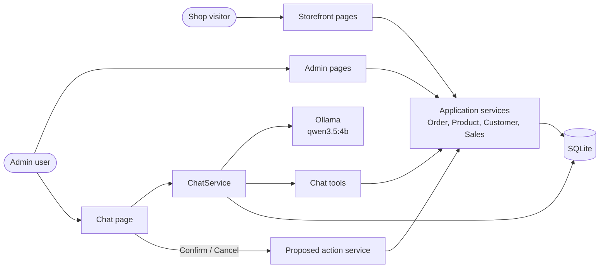

The chat never talks to the database directly. Every read and write goes through the same application services as the admin pages.

## 2.2 Packages

| Package | Why |
|---|---|
| `Dapper` | Maps SQL results to C# objects (D12) |
| `Microsoft.Data.Sqlite` | SQLite ADO.NET driver |
| `Microsoft.Extensions.AI` | `IChatClient`, `ChatClientBuilder`, `UseFunctionInvocation`, `AIFunctionFactory` |
| `OllamaSharp` | `OllamaApiClient` implements `IChatClient` |
| `Microsoft.Extensions.AI.OpenAI` | Adapts an OpenAI-compatible API to `IChatClient` (the `OpenAI` provider) |
| `xunit`, `xunit.runner.visualstudio`, `Microsoft.NET.Test.Sdk` | Tests |
| `Microsoft.Extensions.TimeProvider.Testing`, `Microsoft.AspNetCore.Mvc.Testing` | Test project only: `FakeTimeProvider` and page-level tests. The web project gets no extra packages. |
| `tailwindcss`, `@tailwindcss/cli` (npm, exact pinned v4 version) | Builds `wwwroot/css/app.css`. Used at build time only, never shipped to the browser as a script. |

Cookie authentication and `PasswordHasher<T>` are part of the ASP.NET Core shared framework, so sign-in needs no extra package. No other dependencies.

## 2.3 Domain and data model

```
Product      Id, Name, Brand, Category, Price (decimal), Stock (int), ImageFile (nullable)
Customer     Id, Name, Email, Phone, Address
Order        Id, CustomerId → Customer, OrderDate (DateTime), Status (OrderStatus), Total (decimal), Lines
OrderLine    Id, OrderId, ProductId → Product, Quantity, UnitPrice
OrderStatus  Pending | Dispatched | Delivered | Cancelled   (stored as text)

ChatConversation  Id, UserId, Title, CreatedAt, UpdatedAt
ChatMessage       Id, ConversationId, Role (User | Assistant | ActionResult), Text,
                  PayloadKind (nullable), PayloadJson (nullable), IsError, CreatedAt
ProposedAction    Id (Guid), UserId, ConversationId, MessageId (nullable), RequestMessageId,
                  ActionType (OrderStatusChange | ProductUpdate), ArgumentsJson, Summary,
                  IsCritical, CriticalWarning (nullable),
                  Status (Pending | AwaitingFinalConfirm | Applying | Confirmed | Cancelled | Expired | Failed),
                  CreatedAt, FirstConfirmedAt (nullable), ResolvedAt (nullable), ResultText (nullable)
AuditEntry        Id, OccurredAt, UserId, UserEmail, UserRole,
                  Source (AdminPanel | Chat), EntityType (Order | Product), EntityId,
                  Action (OrderStatusChanged | ProductCreated | ProductUpdated), Summary,
                  ChangesJson ([{ field, old, new }]),
                  ConversationId (nullable), ChatMessageId (nullable: the user's request message),
                  ProposedActionId (nullable), ChatRequestText (nullable),
                  ConfirmationCount (nullable: 1 or 2, chat only)
AdminUser         Id, Email (unique, case-insensitive), PasswordHash, Role (Level1 | Level2),
                  FailedAttempts, LockoutUntil (nullable)
```

Tables use snake_case names (`products`, `orders`, `order_lines`, `admin_users`, `chat_messages`, …), with foreign keys and `ON DELETE` rules declared in SQL. Dapper maps them to the C# names with `DefaultTypeMap.MatchNamesWithUnderscores = true`.

- **Status rules** live in `OrderStatusRules.CanChange(from, to)` and in `Order.ChangeStatus(to)`. `ChangeStatus` throws `DomainException` with the FR-D1 message. Every path (admin page, chat confirm) loads the order, calls `ChangeStatus`, then saves it.
- **Product rules** live in `ProductRules.Validate(price, stock)` (FR-D2 ranges), which throws `ValidationException` with the field messages. `ProductService.CreateAsync` and `UpdateAsync` call it, and `propose_product_update` calls the same method, so the Edit form and the chat give the same messages. The "no change" check (FR-D2) is in `UpdateAsync`, which knows the current values.
- **Audit triggers and the chat columns.** The audit table is created once, before the chat, with every column above. The `Source` CHECK allows `AdminPanel` and `Chat`. The chat never alters the audit table.
- **Critical marker.** "Confirmed twice" is shown when `ConfirmationCount = 2`; there is no separate critical flag on the entry.
- **Money.** SQLite has no decimal type, so money is stored as whole cents in `INTEGER` columns (`price_cents`, `total_cents`, `unit_price_cents`). Queries read them into `long ...Cents` properties, and `Money.FromCents` / `Money.ToCents` convert at the service boundary, so pages and tools only see `decimal`. Filters, sorting, and `SUM(total_cents)` all run in SQL.
- **Dates** are `TEXT`, always written through parameters, so the stored format is the same everywhere and text comparison orders them correctly. Date ranges use `order_date >= @from AND order_date < @toExclusive`.
- **Enums** are stored as `TEXT`. Parameters pass `status.ToString()`, and Dapper parses the text back into the enum on read. A CHECK constraint lists the valid values.
- **Guids** (`proposed_actions.id`) are stored as `TEXT`, with a small Dapper type handler for `Guid`.
- **Order.Total** is stored, set from the lines when the order is created (seed only).
- **Indexes:** `orders(order_date)`, `orders(status)`, `chat_messages(conversation_id, created_at)`, `proposed_actions(conversation_id, status)`, `audit_entries(occurred_at)`, `audit_entries(entity_type, entity_id)`, and unique `admin_users(email COLLATE NOCASE)`.
- **Append-only audit** (FR-AU6): the migration that creates `audit_entries` also creates two triggers, `BEFORE UPDATE` and `BEFORE DELETE`, that run `RAISE(ABORT, 'audit entries are append-only')`. `UserEmail` and `UserRole` are copied into the entry, so it stays readable even if the user changes later.

### Data access with Dapper

- **`Db`** (singleton) holds the connection string. `Db.OpenAsync()` returns an open `SqliteConnection` with `PRAGMA foreign_keys = ON` and `PRAGMA busy_timeout = 5000`. Each service method opens a connection, runs its SQL, and disposes it. There is no repository layer: the services own their SQL, next to the logic that uses it.
- **Writes that touch more than one row** run inside one `SqliteTransaction`: each service write with its audit entry; at the start of a chat turn, creating the conversation (if new), expiring its pending actions, and saving the user message; at the end of a turn, saving the assistant message and linking the proposal to it. The two halves of a turn are separate transactions because the model call sits between them.
- **SQL style**: parameterised only (`@name`), explicit column lists (no `SELECT *`), and one statement per purpose. Search filters build the `WHERE` clause from fixed fragments, and only parameter values come from input. Text search uses `LIKE @term ESCAPE '\'`, with `%`, `_`, and `\` escaped in the term.
- **`DbMigrator`** runs at startup. It creates `schema_version(version, applied_at)` if missing, then runs each embedded `Data/Migrations/NNNN_name.sql` that has not been applied yet, in number order. Each script runs in its own transaction, together with its `schema_version` row. It also sets `PRAGMA journal_mode = WAL` once. Scripts are never edited after they are committed; a change means a new script.

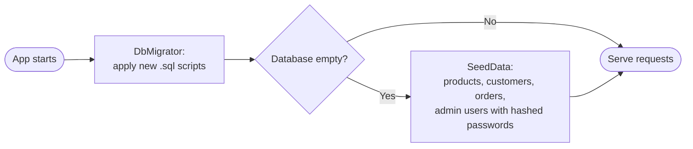
- **Product.ImageFile** holds a file name inside `wwwroot/images/products/`, never a URL or a path. The page builds the image URL from it, and falls back to `placeholder.jpg` when it is empty. Images have `alt` text set to the product name.
- **Startup:** before serving requests, the app applies migrations and seeds an empty database (D10). The database path comes from the connection string. In Docker it is `/app/data/finguitar.db`, on the data volume.

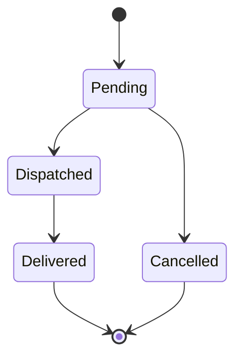

Any change not drawn above is rejected (FR-D1).

## 2.4 Application services

All services are scoped and async, and they take `Db`, `TimeProvider`, and `CurrentUser` as needed. Pages and chat tools both call them.

| Service | Methods |
|---|---|
| `OrderService` | `SearchAsync(OrderFilter, page, pageSize)` → `(rows, totalCount)`; `GetDetailsAsync(id)` → detail or null; `GetAllowedNextStatuses(order)`; `ChangeStatusAsync(id, newStatus)` **[Level1, audited]** |
| `ProductService` | `SearchAsync(ProductFilter, page, pageSize)`; `GetAsync(id)`; `CreateAsync(ProductInput)` **[Level1, audited]**; `UpdateAsync(id, price?, stock?)` **[Level1, audited]** |
| `CustomerService` | `SearchAsync(text, page, pageSize)`, where `text` matches name, email, or phone (partial); `GetDetailsAsync(id)` with order history |
| `SalesService` | `GetSummaryAsync(from, to)` → count and revenue (D7); `GetTopProductsAsync(from, to, count)`; `GetDashboardAsync()`, built from both, so the dashboard and chat use one calculation (acceptance 8) |
| `AuditService` | `RecordAsync(connection, transaction, change)` (called only by the write methods, never by pages or tools); `SearchAsync(AuditFilter, page, pageSize)`; `GetForEntityAsync(type, id, count)` |
| `ChangeContext` | Scoped. Holds the origin of changes in this request: `Source` (default `AdminPanel`) and the chat fields. `MarkAsChat(conversationId, chatMessageId, proposedActionId, requestText, confirmationCount)` sets them. |
| `AuthService` | `SignInAsync(email, password)` and `SignOutAsync()` (see 2.5.1) |
| `CurrentUser` | Wraps `IHttpContextAccessor`: `UserId`, `Email`, `Role`, `IsLevel1`, `IsAdmin`, and `RequireLevel1()`, which throws `ForbiddenException` |

These are the signatures an ordinary admin web app would have. None of them take chat-specific parameters, and the chat calls them unchanged.

- `OrderFilter`: `OrderId?, CustomerName?, ProductName?, Status?, DateFrom?, DateTo?, MinTotal?, MaxTotal?`. Text filters use `LIKE '%' || @term || '%' ESCAPE '\'`. SQLite `LIKE` is case-insensitive for ASCII. The product name filter uses `EXISTS (SELECT 1 FROM order_lines … )`. `DateTo` includes the whole day. Results are sorted newest first, and a second `COUNT(*)` query with the same `WHERE` gives `totalCount`. The Orders page and the `search_orders` tool use the same `OrderFilter` and the same method: the page shows a filter form and pages of 25, and the tool asks for page 1 with a page size of 20 (FR-C4). The Orders page form includes every filter field (product, total range, and order id, as well as status, date, and customer), so no field exists only for the chat.
- `ProductFilter`: `Text?` (matches name, brand, or category, partial), `LowStockOnly` (stock ≤ 3, FR-D3). Sorted by name. Same rules for paging and `totalCount` as `OrderFilter`.
- `AuditFilter`: `DateFrom?, DateTo?, Source?, UserId?, EntityType?, EntityId?`. Newest first.
- Write methods call `CurrentUser.RequireLevel1()` first (FR-A3). Validation failures throw `ValidationException` and rule failures throw `DomainException`. Pages show these as model-state errors, and chat tools turn them into `{ error }` results. A `ForbiddenException` that reaches a page (for example, a direct POST by a Level2 user) is turned into a 403 response that shows the `Account/AccessDenied` page.
- **Stale cards** (D6): a product card records the price and stock it showed. Before applying it, the confirm step (chat code) reads the product with `ProductService.GetAsync`. If the product has changed since the card was shown, the action is marked `Failed` ("Product 7 changed since this was proposed. Ask again."). Otherwise it calls the normal `UpdateAsync`. This check lives in the chat layer, so `UpdateAsync` stays as the Edit page uses it.

### 2.4.1 Audit trail (D15)

The rule "every change is audited" belongs to the write methods themselves, so no caller can forget it.

Auditing is a normal feature of the admin app, and it would exist without the chat. The audit table and `ChangeContext` are built before the chat with every origin column (2.3). The chat only *uses* `ChangeContext.MarkAsChat` to say "this change came from the chat", and it does so without changing any method signature.

- **Inside one transaction**, each write method: reads the current row; applies the domain rule; updates the row; and calls `AuditService.RecordAsync` with the field-level before and after values. If any step throws, the transaction rolls back, so no change exists without its audit entry and no entry exists without its change (FR-AU1).
- **Who** comes from `CurrentUser` (id, email, and role claims).
- **Where from** comes from `ChangeContext`, a scoped (per-request) object that `AuditService` reads.
  - By default it says **Admin panel**, so the admin pages need nothing extra.
  - Before calling the normal write method, the chat's confirm step calls `changeContext.MarkAsChat(conversationId, chatMessageId, proposedActionId, requestText, confirmationCount)`.
  - This keeps `ChangeStatusAsync(id, newStatus)` and `UpdateAsync(id, price?, stock?)` exactly as the pages use them. `ChangeContext` is the one hook the chat uses in the existing app (2.4.2).

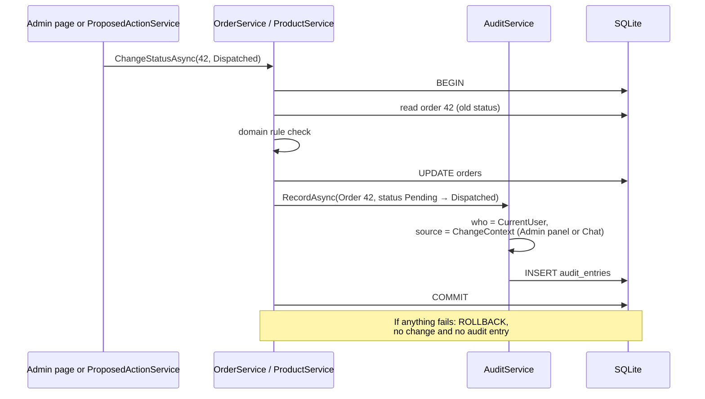

**Audit page** (`/Admin/Audit`, policy `Admin`):
- **Filters:** a filter bar with date from/to, source (All / Chat / Admin panel), user, entity type, and entity id. Filters are carried in the query string, so a filtered view can be linked to, for example from an order's History section (FR-AU7).
- **List:** a table of 50 rows per page with Previous and Next. Columns: time, user (email and role badge), source badge, entity (linked to its detail page), and a summary such as "Status: Pending → Dispatched".
- **Chat rows** carry a sunburst-coloured **Chat** badge with a speech-bubble icon. Under the summary is a quoted line with the original request ("order 42 is dispatched"). Critical entries (`ConfirmationCount = 2`) also show a rose **Confirmed twice** marker.
  - The **View in chat** link to `/Admin/Chat?c={conversationId}#m{chatMessageId}` is shown only when the entry's `UserId` is the signed-in user, since the user who made a chat change owns that conversation. No chat tables are read. Other admins see the quote without a link. Opening someone else's conversation by URL still returns 404 (2.6.7).
- **Before the chat exists**, the audit page shows the Source as plain text. The seam (2.4.2) adds the Chat badge, the quote, the link, and the marker.
- **Admin panel rows** carry a neutral **Admin panel** badge.
- **Expanding a row** shows the field-level changes as a small old → new table.
- **Empty state:** "No changes yet. Try 'order 42 is dispatched' in the chat."

### 2.4.2 Reuse map: how the chat plugs into the existing app (D17)

**Tool to existing method.** Each tool is a thin adapter. It validates and parses the model's arguments, calls a method the admin pages already use, and shapes the result for the model and the chat table.

| Chat tool / step | Existing method it calls | Admin page that uses the same method |
|---|---|---|
| `search_orders` | `OrderService.SearchAsync(OrderFilter, 1, 20)` | Orders list |
| `get_order_details` | `OrderService.GetDetailsAsync(id)` | Order detail |
| `propose_order_status_change` (validation) | `OrderService.GetDetailsAsync` + `GetAllowedNextStatuses` | Order detail (decides which status buttons to show) |
| `search_products` | `ProductService.SearchAsync(ProductFilter, 1, 20)` | Products list (including the low-stock filter) |
| `propose_product_update` (validation) | `ProductService.GetAsync(id)` + `ProductRules.Validate(price, stock)`, the same rule `UpdateAsync` applies for the Edit form | Product edit |
| `search_customers` | `CustomerService.SearchAsync(text, 1, 20)` | Customers list |
| `get_customer_details` | `CustomerService.GetDetailsAsync(id)` | Customer detail |
| `get_sales_summary` | `SalesService.GetSummaryAsync(from, to)` | Dashboard revenue tiles |
| `get_top_products` | `SalesService.GetTopProductsAsync(from, to, count)` | Dashboard "Top sellers this week" panel |
| Confirm: order status | `OrderService.ChangeStatusAsync(id, newStatus)` | Order detail status buttons |
| Confirm: product update | `ProductService.UpdateAsync(id, price?, stock?)` | Product edit form |

**What the chat adds as new code** (everything under `Chat/`, plus its pages, partials, and script):
- `ChatService`, `ChatTools`, `ChatToolCatalog`, `ChatPrompt`, `ThinkStripper`, and the chat payload records
- `ProposedActionService` and `CriticalActionPolicy`
- `Pages/Admin/Chat`, `Shared/Chat/*` partials, and `wwwroot/js/chat.js`
- A migration script for the chat tables (`chat_conversations`, `chat_messages`, `proposed_actions`)

**What the chat changes in the existing app** (the "seam", kept as small as possible):

| Change | Why |
|---|---|
| `Program.cs`: register the chat client, the chat services, and the `Llm` options | Wire up the new feature |
| `FinGuitar.Web.csproj`: add the `Microsoft.Extensions.AI`, `Microsoft.Extensions.AI.OpenAI` and `OllamaSharp` package references | The chat's only new dependencies |
| `appsettings.json`: add the `Llm` section (`Provider`, `Endpoint`, `Model`, `ApiKey`, `TimeoutSeconds`) | Chat configuration |
| `_AdminLayout`: add a "Chat" nav item | Reach the page |
| Audit page: show the Chat badge, the quote, the owner-only "View in chat" link, and "Confirmed twice" when the chat columns are set | FR-AU5 |

The audit columns and `ChangeContext.MarkAsChat` already exist before the chat (2.4.1), so the chat adds **no migration to existing tables** and **no change to any service**. Nothing else in the existing app changes for the chat. In particular, no service method gains a parameter for it, and no domain rule or validation is copied into chat code: the chat gets the same rules and error messages because it calls the same methods.

**Adding a service method.** If a tool needs something no page has, add the method to the service in a form a page could also use, and use it from a page where that makes sense. `GetTopProductsAsync`, for example, also feeds the dashboard. Do not add chat-only methods to services.

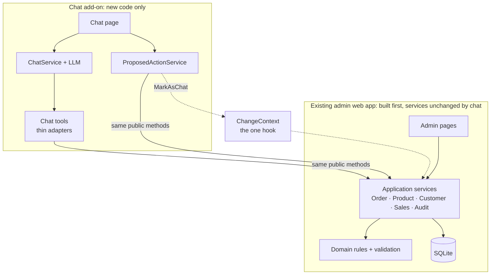

## 2.5 Authorization

### 2.5.1 Sign-in (D13)

- **Setup:** `AddAuthentication(CookieAuthenticationDefaults.AuthenticationScheme).AddCookie(...)`. The cookie is HttpOnly and `SameSite=Lax`, with an 8-hour sliding expiry, `LoginPath = /Account/Login`, and `AccessDeniedPath = /Account/AccessDenied`.
- **`AuthService.SignInAsync`:**
  1. Load the user by email. If there is none, return "Invalid email or password." Still run a dummy hash check, so a wrong email takes about as long as a wrong password.
  2. If `LockoutUntil` is in the future, return "Too many attempts. Try again in a few minutes."
  3. `PasswordHasher<AdminUser>.VerifyHashedPassword`. If it fails, add 1 to `FailedAttempts`, and at 5 set `LockoutUntil = now + 5 minutes` and reset the count. Then return "Invalid email or password."
  4. If it succeeds, reset `FailedAttempts`. If the result is `SuccessRehashNeeded`, save the new hash. Then call `HttpContext.SignInAsync` with the claims `NameIdentifier` (user id), `Name` (email), and `Role`.
- **Seeding** hashes the demo passwords with the same `PasswordHasher`. Plain-text passwords exist only in `SeedData` and the README.
- **Roles** are read from the cookie. Users and roles cannot change while the app runs (there is no user management), so this is safe.
- **Known trade-off (D13):** "Too many attempts" appears only for an existing account, so it reveals that the email exists. This is accepted for a local demo with public demo users, and page 02 says so.

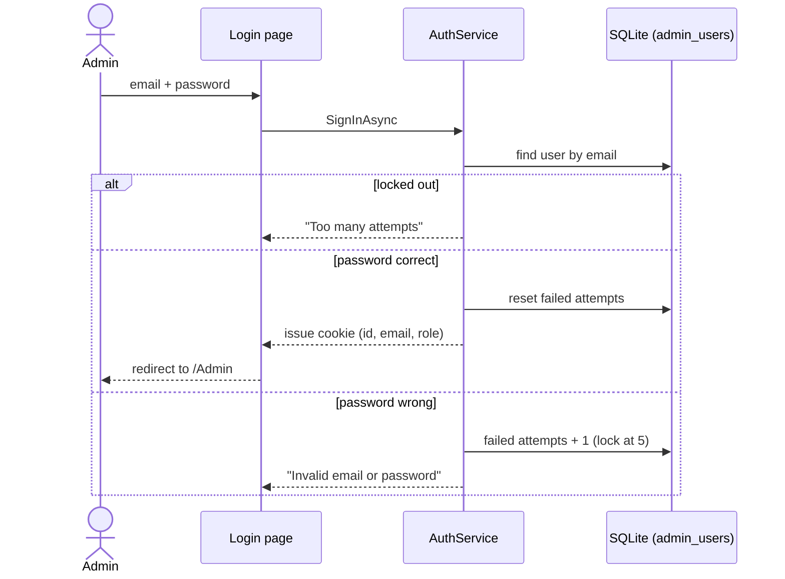

### 2.5.2 Access rules

- `AuthorizeFolder("/Admin", "Admin")`, where the policy `Admin` requires role `Level1` or `Level2`.
- `Admin/Products/Create` and `Admin/Products/Edit` are authorized with policy `Level1`.
- The status-change handler on `Admin/Orders/Details` is open to any admin page user, but it calls `OrderService.ChangeStatusAsync`, which enforces Level1. The buttons are hidden for Level2. Only the allowed next statuses get a button (`GetAllowedNextStatuses`). **Cancel** first shows a confirmation panel (D20): the button links to `/Admin/Orders/Details/42?confirm=cancel`, which renders the panel with a POST form for "Yes, cancel order 42" and a "Keep order" link back. It needs no JavaScript and works with a keyboard.
- The chat **confirm** and **cancel** handlers go through `ProposedActionService`, which checks owner, status, expiry, and role (FR-C10), and then calls the Level1-guarded service. That makes three layers: tool filtering, the tool's own check, and the service check.

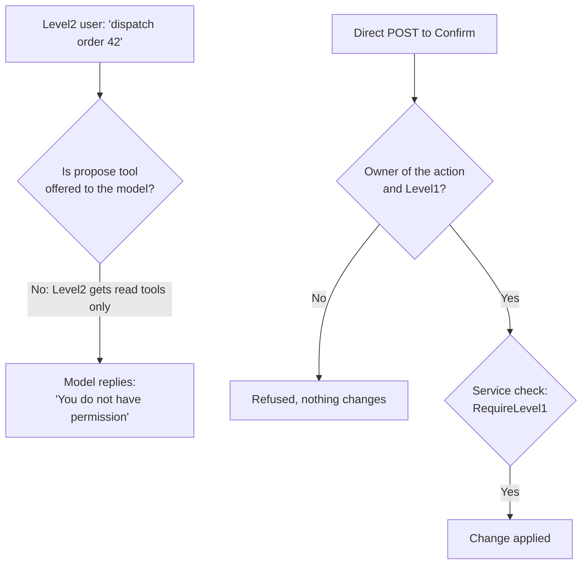

## 2.6 Chat design

### 2.6.1 Model client

```csharp
services.AddChatClient(sp => new OllamaApiClient(new Uri(opts.Endpoint), opts.Model))
        .UseFunctionInvocation(configure: f => { f.MaximumIterationsPerRequest = 5; });
```

- `appsettings.json`: `"Llm": { "Provider": "Ollama", "Endpoint": "http://localhost:11434", "Model": "qwen3.5:4b", "TimeoutSeconds": 120 }`. With `"Provider": "OpenAI"` the app builds an OpenAI-compatible client from `Endpoint`, `Model` and `ApiKey` instead (an unknown provider, or `OpenAI` without a key, fails with a clear message)..
- `think = false` is passed per request (D4). **The spike confirms how**: either `ChatOptions.AdditionalProperties["think"]` or OllamaSharp's request options. `ThinkStripper` strips any `<think>…</think>` block that still appears, as the fallback.
- Temperature is 0.1, for more predictable tool selection.

### 2.6.2 Tools

`ChatTools` is a scoped class with one method per tool. Each method:
1. checks the role itself (Level1 for `propose_*`) and returns `{ error: "You do not have permission…" }` if the check fails;
2. validates and parses the arguments: ISO dates, status names (case-insensitive, with an error listing the valid values), and ranges;
3. calls the application service;
4. returns a small typed record to the model, and **records the same result** in a per-turn `ToolResultLog` (scoped) as a `ChatPayload` so the server can render it;
5. catches `DomainException`, `ValidationException`, `ForbiddenException`, and not-found cases, and returns `{ error }` (FR-C12).

Tools contain **no business logic of their own**. Rules, validation messages, and data access all come from the service methods the admin pages use (2.4.2). A tool only translates: model arguments in, service call, compact result out.

`ChatToolCatalog` holds, for each tool, the name, a short description, and the allowed roles. It builds the `AIFunction` list for the current user with `AIFunctionFactory.Create(method, name, description)`, bound to the scoped `ChatTools` instance. Level2 users never see `propose_*` tools (FR-C2).

The tools (all arguments optional unless marked *required*; dates are `yyyy-MM-dd`):

| Tool | Arguments | Result payload | Roles |
|---|---|---|---|
| `search_orders` | `orderId`, `customerName`, `productName`, `status`, `dateFrom`, `dateTo`, `minTotal`, `maxTotal` | `OrderTable` (≤ 20 rows, `totalCount`) | L1, L2 |
| `get_order_details` | `orderId` *required* | `OrderDetail` | L1, L2 |
| `propose_order_status_change` | `orderId` *required*, `newStatus` *required* | `ProposalCard` | L1 |
| `search_products` | `text` (name, brand, or category), `lowStockOnly` (bool) | `ProductTable` (≤ 20 rows, `totalCount`) | L1, L2 |
| `propose_product_update` | `productId` *required*, `newPrice`, `newStock` (at least one) | `ProposalCard` | L1 |
| `search_customers` | `text` (name, email, or phone) | `CustomerTable` (≤ 20 rows, `totalCount`) | L1, L2 |
| `get_customer_details` | `customerId` *required* | `CustomerDetail` | L1, L2 |
| `get_sales_summary` | `dateFrom` *required*, `dateTo` *required* | `SalesSummary` | L1, L2 |
| `get_top_products` | `dateFrom` *required*, `dateTo` *required*, `count` (1–10, default 5) | `TopProducts` | L1, L2 |

Tool results sent to the model are compact JSON (ids, key fields, and `totalCount`). The rendered tables use the richer `ChatPayload`.

Write tools:
- **One change per turn** (D18): if `ToolResultLog` already holds a proposal for this turn, both `propose_*` tools return `{ error: "One change at a time. Ask the user to confirm this one first." }` without doing anything.
- `propose_order_status_change(orderId, newStatus)`: calls `OrderService.GetDetailsAsync` and checks `newStatus` against `OrderService.GetAllowedNextStatuses(order)` (D5). If the change is not allowed, it returns the FR-D1 message as `{ error }`. Otherwise it calls `ProposedActionService.ProposeAsync`, which expires the other pending actions **in this conversation** (D2), and returns `{ proposalId, summary, critical, note: "Waiting for the user to click Confirm." }`.
- `propose_product_update(productId, newPrice?, newStock?)`: at least one value is required. It calls `ProductService.GetAsync` and `ProductRules.Validate`, and rejects a no-op with the FR-D2 message. Arguments are saved with the current values, which the confirm step checks.
- **Critical check** (FR-C15): `CriticalActionPolicy.Evaluate(actionType, current, proposed)` returns `(isCritical, warning)`. It is a static class in `Chat/` and the only place the rules and the 20% threshold live. `ProposeAsync` calls it and stores `IsCritical` and `CriticalWarning` on the action, so the decision never depends on the model.

### 2.6.3 One chat turn (`POST /Admin/Chat?handler=Send`)

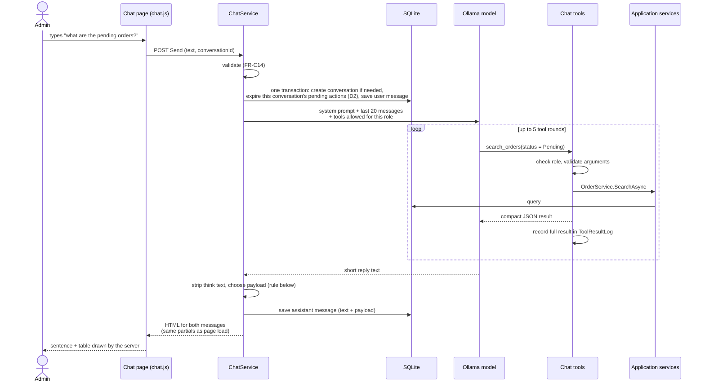

- **Payload rule.** If the turn created a proposal, the payload is that proposal card. Otherwise it is the result of the **last successful** data tool call in the turn. If there was none, the message has no payload. This covers "search, then get details" by showing the details.
- **History sent to the model.** User messages are sent as they are. Assistant messages are sent as their text plus a one-line payload summary, for example `[Shown: orders 12, 15, 19]`, so that "the second one" can be resolved. ActionResult messages are sent as assistant text. Messages with `IsError = true` are **not** sent, so a past outage does not teach the model to refuse. Tool call messages from earlier turns are not re-sent, which keeps the context small for a 4B model.
- **Errors (FR-C13).** `HttpRequestException`, a timeout, or `OperationCanceledException` from the model client is saved as an Assistant message with `IsError = true` and the friendly text. A "model not found" response from Ollama gives the "still downloading" text (D21). An HTTP failure from the OpenAI-compatible client (`ClientResultException`, such as a bad key) is treated like an unreachable service. Any other exception is logged and shown as a generic "Something went wrong." message. The page never crashes.
- **Round limit (D22).** If the function-invocation client stops at 5 rounds and the last response still holds tool calls or no text, the reply is the D22 message with `IsError = true`, and the payload rule still applies.
- **Conversation title.** A new conversation is titled with the first user message, cut to 60 characters.
- One send is processed at a time per page. The send button is disabled until the reply arrives.

### 2.6.4 System prompt (`ChatPrompt`)

It is short and built for each request:
- "You are the FinGuitar admin assistant. Today is {Friday 2026-10-10}. Use yyyy-MM-dd for dates. Weeks start on Monday."
- "The user's role is {Level1: can view and change data | Level2: read-only}. If a Level2 user asks to change data, say politely that they do not have permission."
- "Answer only from tool results. Never invent orders, products, customers, or numbers. The app shows tables to the user automatically, so do not repeat table rows. Write one or two sentences."
- "To change data, call a propose_* tool, one change at a time. The user must click Confirm on the card; typing 'yes' does not confirm anything. The app asks twice for critical changes. Never say a change is done until it is confirmed."
- "When searching for an order: if one matches, call get_order_details. If several match, ask the user to pick one. If none match, suggest loosening the filters."

### 2.6.5 Proposed actions (`ProposedActionService`)

| Operation | Behaviour |
|---|---|
| `ProposeAsync(conversationId, requestMessageId, type, args, summary)` | Sets the conversation's other `Pending` and `AwaitingFinalConfirm` actions to `Expired`, evaluates `CriticalActionPolicy`, then inserts a new `Pending` action. |
| `ExpirePendingForConversationAsync(conversationId)` | Called at the start of every Send, for that conversation only (D2). |
| `ConfirmAsync(id)` | First confirm. 1) Load the action; return "not found" if it does not exist or belongs to another user. 2) `RequireLevel1()`. 3) If it is older than 10 minutes, mark it `Expired` and return "expired". 4a) **Critical:** atomically move `Pending → AwaitingFinalConfirm` (`UPDATE … WHERE id = @id AND status = 'Pending'`), set `FirstConfirmedAt`, and save a server-written Assistant message with the `FinalConfirmCard` payload. No data changes. 4b) **Not critical:** apply it (see *Apply* below), claiming it from `Pending`. |
| `FinalConfirmAsync(id)` | Second confirm, for critical actions only. It makes the same checks as steps 1 to 3, then applies the action, claiming it from `AwaitingFinalConfirm`. If the action is in any other state, including `Pending` (the first confirm was skipped), it is refused (FR-C17). |
| *Apply* (shared) | 1) **Claim** it atomically: `UPDATE proposed_actions SET status = 'Applying' WHERE id = @id AND status = @expected`. If 0 rows change, it was already used, so reject it. 2) For a product update, make the stale-card check (2.4). 3) `changeContext.MarkAsChat(conversationId, requestMessageId, actionId, requestText, confirmationCount = critical ? 2 : 1)`. 4) Call the **same service method the admin page uses**: `OrderService.ChangeStatusAsync(id, newStatus)` or `ProductService.UpdateAsync(id, price?, stock?)`. That method runs its own transaction with the domain rules and the audit entry (2.4.1). 5) On success, set `Confirmed`. On `DomainException`, `ValidationException`, or a stale card, set `Failed` with the reason (D6); the service has already rolled back, so nothing changed. 6) Save an ActionResult message (D3). |
| `CancelAsync(id)` | Owner only, while the action is `Pending` or `AwaitingFinalConfirm`. Sets `Cancelled` and saves an ActionResult message. On the final card, the "Keep order" (or "Keep current value") button calls this. |

`ExpirePendingForConversationAsync` and `ProposeAsync` expire actions in both the `Pending` and `AwaitingFinalConfirm` states, in one conversation only. A user can have live cards in several conversations. The 10-minute limit is checked when a card is confirmed or rendered, so no background job is needed.

**Why `Applying` exists.** The claim and the service call are two steps, because the service method keeps its normal signature and opens its own transaction. `Applying` marks the action as taken, so a double click cannot run it twice. If the app stopped between the two steps, the action would stay `Applying`. The card then shows "Outcome unknown. Check the audit page." The audit entry is written in the same transaction as the change, so the audit page is always the source of truth.

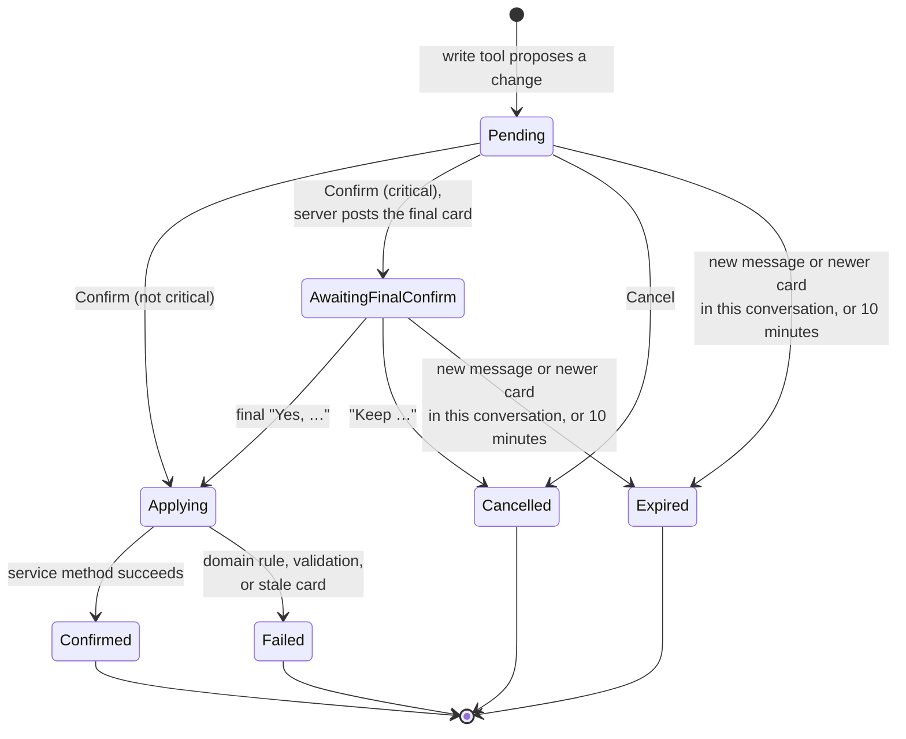

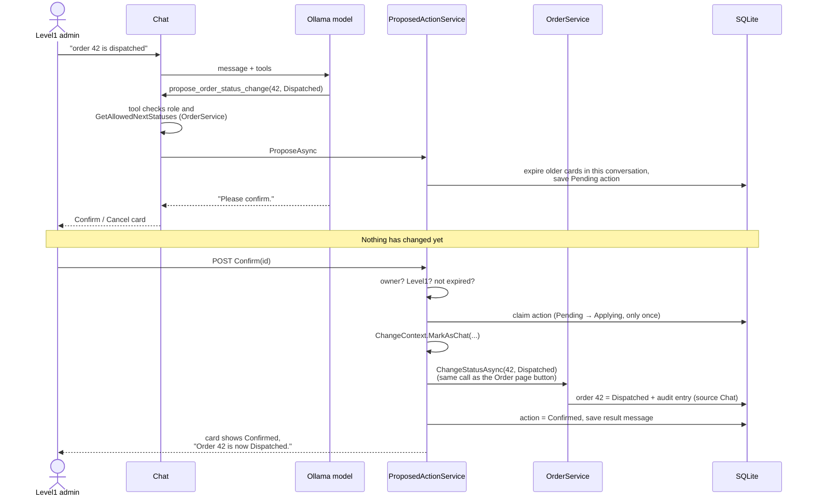

The sequence above is the non-critical case. For a **critical** action, such as "cancel order 42", there is an extra step:

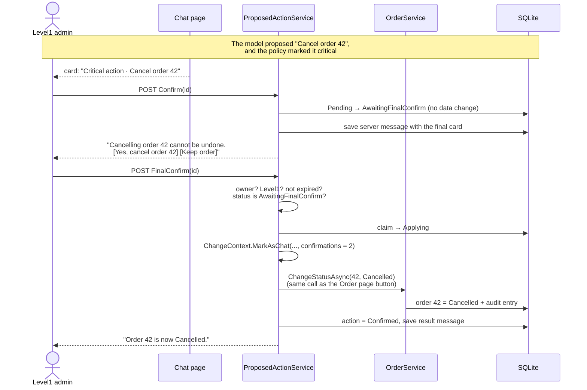

Endpoints: `POST /Admin/Chat?handler=Confirm&id=…`, `…handler=FinalConfirm`, and `…handler=Cancel`, all with anti-forgery. They return the updated card plus any new message (the final card or the result) as HTML.

### 2.6.6 Rendering

- `_Message.cshtml` renders a message bubble and then switches on `PayloadKind` to a partial: `OrderTable`, `OrderDetail`, `ProductTable`, `CustomerTable`, `CustomerDetail`, `SalesSummary`, `TopProducts`, `ProposalCard`, or `FinalConfirmCard`.
- `ProposalCard` and `FinalConfirmCard` show the hint "Use the buttons to confirm. Sending a message expires this card." while they are live (D2).
- `ProposalCard` for a critical action has a "Critical action" header. `FinalConfirmCard` shows the stored `CriticalWarning`, a danger button that names the action ("Yes, cancel order 42"), and a "Keep …" button. The danger button sits on the right and the safe button on the left, the reverse of the first card, so a double click cannot confirm both steps by accident. The danger button is also disabled for the first second after the card appears.
- Table rows link to the matching admin page, for example `/Admin/Orders/Details/42`.
- `ProposalCard` and `FinalConfirmCard` read the **current** `ProposedAction` status from the database, not from the saved JSON, so a reloaded card shows the right state (FR-C11). Buttons appear only while the action is in that card's step (`Pending` or `AwaitingFinalConfirm`) and less than 10 minutes old.
- The page load and the AJAX responses use the same partials. Message text is HTML-encoded and is not rendered as markdown.
- Each message element has `id="m{messageId}"`, so the audit page's "View in chat" link scrolls to the request.

### 2.6.7 Chat page layout

The left side lists the user's conversations, newest first, with a **New chat** button. The main area shows the messages, an input box, and the send button. The URL is `/Admin/Chat?c={conversationId}`. A user can open only their own conversations; any other id returns 404.

## 2.7 Frontend

### 2.7.1 Tailwind setup

- **Tailwind CSS v4**, configured in CSS. `Styles/app.css` holds `@import "tailwindcss";`, `@source` lines for `Pages/**/*.cshtml` and `wwwroot/js/**/*.js`, the theme tokens in `@theme`, and a small set of component classes in `@layer components`.
- **Build:** `npm run css:build` runs `@tailwindcss/cli -i Styles/app.css -o wwwroot/css/app.css --minify`. `npm run css:watch` rebuilds while developing. Docker runs the build in its own stage (2.8.3), so Docker users never need Node.
- **No CDN.** The generated file is served by the app. The Tailwind "Play CDN" script is not used: it is not meant for production, and it would break running fully offline (NFR-2).
- **Fonts** are self-hosted `woff2` files in `wwwroot/fonts/`, with their licence files: **Fraunces** (display headings, storefront) and **Inter** (all body text, and the whole admin panel). Both are under the SIL Open Font License.
- **Component classes** keep the Razor markup readable and the look consistent: `.btn`, `.btn-primary`, `.btn-ghost`, `.card`, `.input`, `.badge`, `.data-table`, `.chat-bubble-user`, `.chat-bubble-assistant`, and `.proposal-card`. They are built from Tailwind utilities with `@apply`, and pages use utilities directly for layout.
- **Class names are always written in full.** Tailwind finds classes by scanning files, so names built at run time (for example `"badge-" + status`) would be missing from the CSS. Status badges use a C# `switch` that returns full class strings such as `"badge badge-pending"`.

### 2.7.2 Storefront theme: "Showroom" (white)

The shop feels like a bright guitar showroom: lots of white space, large photos, and one warm accent taken from a sunburst guitar finish.

| Token | Value | Used for |
|---|---|---|
| `--color-showroom-bg` | `#FFFFFF` | Page background |
| `--color-showroom-ink` | `#14161A` | Text |
| `--color-showroom-muted` | `#5B6370` | Secondary text |
| `--color-showroom-stage` | `#F6F3EE` | Warm backdrop behind product photos |
| `--color-sunburst-from` / `-to` | `#F59E0B` → `#B4231B` | Decorative gradient on the hero band and accent strips only. **No text is placed on it** (NFR-10). |
| `--color-sunburst-deep` | `#B4231B` | Solid primary buttons (white text, about 6.6:1) and the focus ring on white (about 6.6:1) |
| `--color-showroom-line` | `#E7E3DC` | Card borders and dividers |

- **Layout** (`_StoreLayout`): a slim top bar with the wordmark set in Fraunces, links (Guitars, Cart with an item count), and a discreet "Admin" link. Below it is a hero band with the sunburst gradient on the home page only. The hero text sits on a solid ink or white panel over the band, never directly on the gradient.
- **Product cards:** the photo sits on the warm stage colour at a 4:3 ratio, with the name in Fraunces, the brand and category as small caps, and the price in bold. A green "In stock" or grey "Out of stock" pill appears on the card. On hover the card lifts slightly (shadow and 2 px raise); this is turned off with reduced motion.
- **Product page:** a large photo on the left, details on the right, and the photo stacks on top on phones. The primary button is "Add to cart", disabled when the product is out of stock.
- **Cart:** a clean table on desktop and stacked cards on phones, with a total panel and the note "Checkout is not part of this demo".

### 2.7.3 Admin theme: "Backstage" (dark)

The admin area feels like a dark stage control desk: calm, high contrast, and dense data. The sunburst accent carries over so both areas look like one brand.

| Token | Value | Used for |
|---|---|---|
| `--color-backstage-bg` | `#0B0D10` | Page background |
| `--color-backstage-panel` | `#14171C` | Sidebar, cards, chat panel |
| `--color-backstage-raised` | `#1B1F26` | Table header, hover rows, inputs |
| `--color-backstage-line` | `#262B33` | Borders |
| `--color-backstage-text` | `#E6E8EB` | Text |
| `--color-backstage-muted` | `#9AA3AE` | Secondary text |
| `--color-sunburst` | `#F59E0B` | Solid primary buttons (text in `--color-backstage-bg` `#0B0D10`, about 9:1), focus rings (about 9:1 on the page background), active nav item |
| Status colours | Pending amber, Dispatched sky, Delivered emerald, Cancelled rose | Order status badges (text on a 15% tint of the same colour) |

- **Layout** (`_AdminLayout`): a fixed left sidebar with the wordmark, nav items (Dashboard, Orders, Products, Customers, Chat, Audit), and the signed-in user with a role badge ("Level1 · full access" or "Level2 · read only") and Sign out. On phones the sidebar becomes a top bar with a menu button.
- **Dashboard:** four stat tiles (orders today, pending, revenue today, revenue this week) with large tabular numbers, then today's orders as a table and a "Top sellers this week" panel.
- **Tables** (`.data-table`): a sticky header, subtle row dividers, a hover highlight, right-aligned tabular numbers for money and quantities, and the status badge in its own column.
- **Chat:** the conversation list on the left and messages in the centre. User messages appear in right-aligned bubbles with a soft amber tint. Assistant messages sit on the panel colour, with the server-drawn table or card inside the bubble at full width. The `.proposal-card` has an amber left border, the summary in larger text, and Confirm (primary) and Cancel (ghost) buttons. Once resolved, the card shows a status pill: Confirmed in green, Cancelled or Expired in grey, Failed in rose with the reason. "thinking…" is shown as three pulsing dots, which stay still with reduced motion.
- **Critical and final cards:** a rose (`#F43F5E`) border and a warning icon, with the consequence in bold. The danger button is solid rose `#E11D48` with white text (about 4.7:1; white on `#F43F5E` would fail AA), and the "Keep …" button is ghost-styled.
- **Audit page:** a compact filter bar above the table. **Chat** badges are sunburst-tinted with a speech-bubble icon, **Admin panel** badges are neutral grey with a panel icon, and **Confirmed twice** is a small rose outline pill. The source is never shown by colour alone: every badge carries its text label and icon (NFR-10).
- **Sign-in page** uses the dark theme: a centred card with the wordmark and, below it, a small box listing the demo logins (this is a demo; see FR-A4).

### 2.7.4 Storefront behaviour

- The session cart is stored as JSON (`productId → quantity`) in `ISession`, using `AddDistributedMemoryCache` and `AddSession`.
- `Cart` page handlers: Add, Update, and Remove. Quantity is limited to 1 through the product's stock. Prices are always read fresh from the database.
- The catalogue is a grid of cards with the photo on top. Images use `loading="lazy"` and a fixed aspect ratio, so the page does not jump while photos load.

## 2.8 Docker

### 2.8.1 What runs

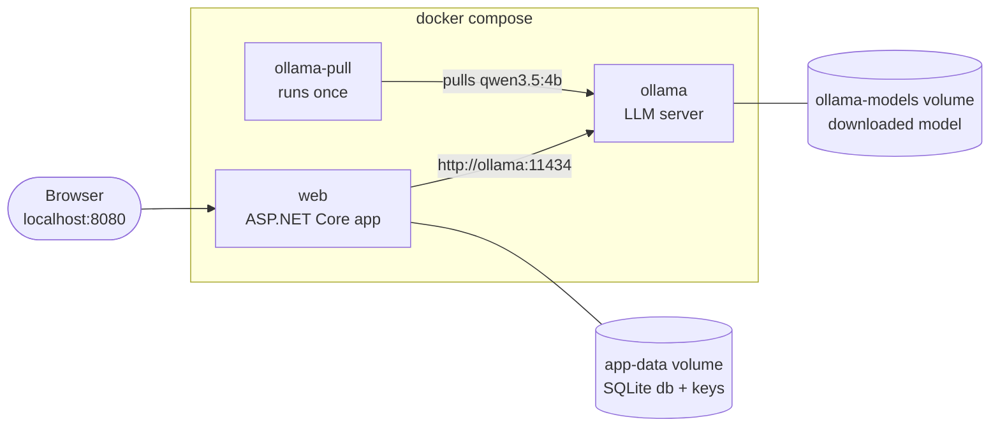

| Service | Image | Job |
|---|---|---|
| `ollama` | `ollama/ollama`, pinned to a tested version tag | Serves the model. Health check: `ollama list`. Its port is not published to the host. |
| `ollama-pull` | The same image | Runs `ollama pull qwen3.5:4b` against the `ollama` service once, then exits. A second pull is a quick no-op. |
| `web` | Built from the repo's `Dockerfile` | The app on port 8080. It starts once `ollama` is healthy. It does **not** wait for `ollama-pull` (D21): the shop and admin panel work at once, and the chat says the model is still downloading until the pull finishes. |

### 2.8.2 First start

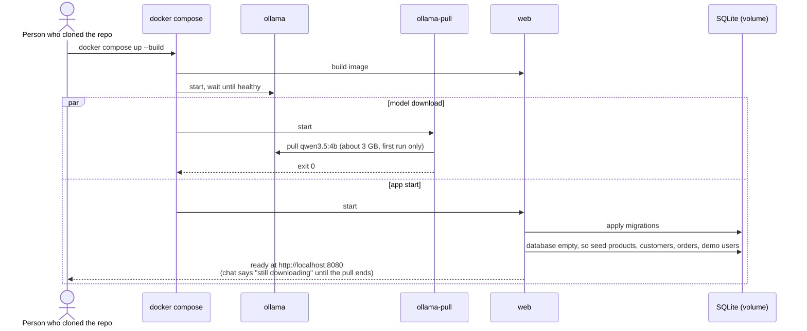

On later starts, the model and database are already in their volumes. Nothing is downloaded and nothing is re-seeded.

### 2.8.3 Dockerfile

Multi-stage, using official images:
1. **css** (`node:22-alpine`, pinned): copy `package.json` and `package-lock.json`, run `npm ci`, copy `Styles/` and the `.cshtml` and `.js` files Tailwind scans, then `npm run css:build`. The output is `wwwroot/css/app.css`.
2. **build** (`mcr.microsoft.com/dotnet/sdk:10.0`): restore (copy the `.csproj` files first so restore is cached), copy the source and the CSS from the css stage, then `dotnet publish -c Release`.
3. **test** (from build): `dotnet test`. This stage is used only by `docker build --target test .` (NFR-9). A normal build skips it.
4. **runtime** (`mcr.microsoft.com/dotnet/aspnet:10.0`): copies the published output, runs as the image's non-root `app` user, exposes 8080, and creates `/app/data` owned by that user.

`.dockerignore` leaves out `bin/`, `obj/`, `node_modules/`, `.git/`, `*.db`, `wwwroot/css/app.css`, and the `docs/` folder. `.gitignore` also lists `node_modules/` and `wwwroot/css/app.css`.

### 2.8.4 Configuration in Compose

`web` environment:

| Variable | Value |
|---|---|
| `ConnectionStrings__Default` | `Data Source=/app/data/finguitar.db` |
| `Llm__Provider` | `Ollama` |
| `Llm__Endpoint` | `http://ollama:11434` |
| `Llm__Model` | `qwen3.5:4b` |
| `Llm__TimeoutSeconds` | `180` (CPU-only machines are slower) |
| `TZ` | Defaults to `UTC`; the README explains how to set it to your time zone (D8) |
| `ASPNETCORE_ENVIRONMENT` | `Production` |

- **Data-protection keys** are saved to `/app/data/keys` (`PersistKeysToFileSystem`), so sign-in cookies and anti-forgery tokens still work after the container restarts.
- **HTTP only.** Inside Docker, the app serves plain HTTP on `localhost:8080`, and HTTPS redirection is turned off. This is a local demo (see 1.6). The sign-in cookie is not marked secure-only in this mode.
- **GPU.** `docker-compose.gpu.yml` adds an NVIDIA GPU reservation to `ollama`. Use it with `docker compose -f docker-compose.yml -f docker-compose.gpu.yml up`. Without it, the model runs on the CPU: slower, but it works everywhere.
- **Port clash.** The host port is set by `WEB_PORT` (default `8080`), so someone with something already on 8080 can change it without editing files.

### 2.8.5 Commands for the README

| Goal | Command |
|---|---|
| Start everything | `docker compose up --build` |
| Stop | `docker compose down` |
| Reset the database and start fresh | `docker compose down -v`, then `up` again (this also deletes the downloaded model) |
| Reset only the database (to replay the guided scenarios with fresh dates, D19) | `docker compose down`, then `docker volume rm <project>_app-data`, then `up` |
| Run the tests | `docker build --target test .` |
| View the app logs | `docker compose logs -f web` |

## 2.9 Testing

Unit and integration tests in `FinGuitar.Tests` use a `FakeTimeProvider` and a fresh in-memory SQLite database per test (`Data Source=file:test-{guid}?mode=memory&cache=shared`). One connection stays open for the test's lifetime so the database survives, and `DbMigrator` builds the schema, so the tests run the same SQL scripts as the app.

| Area | Tests |
|---|---|
| Migrations | An empty database migrates to the latest version. Running the migrator a second time changes nothing. Foreign keys are enforced. |
| Sign-in | A correct password signs in with the right role claim; a wrong password and an unknown email give the same message; the 5th failure locks the account; sign-in is refused while locked and works after 5 minutes (fake time); a success resets the count. |
| Status rules | All 16 from/to pairs: exactly the 3 allowed changes pass, and every other pair throws with the FR-D1 message. |
| Search filters | Each `OrderFilter` field on its own and combined; case-insensitive partial matching; `DateTo` includes the whole day; paging with `totalCount` (page size 25 for the page and 20 for the tool, through the same method); LIKE wildcard escaping. Product low-stock filter. |
| Sales | Revenue excludes Cancelled orders; week boundaries; dashboard equals `GetSummaryAsync`. |
| RBAC | Level2 cannot call service writes (`ForbiddenException`); Level2 tool list has no `propose_*`; Level2 calling a `propose_*` method directly gets the error result; confirm by Level2 is refused. |
| Proposal lifecycle | Owner only; single use (the second confirm fails); expired after 10 minutes; expired by a newer proposal in the same conversation; expired when the user sends a message in the same conversation; a card in **another** conversation stays live; a second `propose_*` in one turn returns the D18 error; a domain failure on confirm gives `Failed` and changes no data; a stale product card is rejected; a no-op product update is rejected. |
| Chat turn | A fake inner `IChatClient` that returns scripted `FunctionCallContent`, wrapped in the real function-invocation client. Checks the payload rule, that the messages and payload are saved, that `IsError` messages are left out of the history, that the history carries payload summaries, that a model connection failure and a "model not found" response give the right `IsError` message, and that reaching the round limit gives the D22 message. Message limits (empty, over 1,000 characters) are rejected. `ThinkStripper` removes `<think>` blocks. |
| Conversations | A user sees only their own conversations; another user's conversation id returns 404 on the page and on Send, Confirm, FinalConfirm, and Cancel. The title is the first message, cut to 60 characters. |
| Cart | Add, update, and remove; quantity limited to 1 through stock; out-of-stock products cannot be added; prices come from the database. |
| Admin cancel | The Cancel button shows the confirmation panel and changes nothing; "Yes, cancel" changes the status and writes one audit entry. |
| Audit | Each write path (admin status change, admin product create/edit, chat confirm, chat final confirm) writes exactly one entry with the right source, user, and field changes. Chat entries carry the conversation, request message id and text, proposal, and confirmation count. The "View in chat" link is rendered only for the entry's own user. A write that fails the domain rule leaves no entry and no change. `UPDATE` and `DELETE` on `audit_entries` are refused by the triggers. The filters and paging work. |
| Same path for page and chat | Changing order 42's status from the admin page and confirming the same change from the chat end in the same database state and the same audit entry, apart from the source and chat fields. A rule violation gives the same error message in both. An invalid product price gives the same validation message from the Edit form and from `propose_product_update`. |
| Critical actions | `CriticalActionPolicy`: a cancel is critical; a price change of 19.9% is not and 20% is (both up and down); stock to 0 is critical and stock to 1 is not; dispatch and deliver are not critical. Lifecycle: the first confirm of a critical action changes no data and creates the final card; `FinalConfirm` on a `Pending` action is refused; a second `FinalConfirm` is refused; sending a message expires an `AwaitingFinalConfirm` action; "Keep" cancels it; a non-critical action applies on the first confirm. |
| Seed data | Seeding an empty database creates the expected products, customers, orders, and both demo users with their roles. Seeding twice does not duplicate anything. The SD-3 cases exist (orders today; John's Les Paul order falls in the previous Monday-based week for every weekday of the first start, checked with fake time; Pending orders 42, 43, and 44; a Delivered order). Every seeded product's `ImageFile` exists on disk and is listed in `CREDITS.md`. |

Docker smoke test (manual, before release): from a clean clone on a machine with only Docker, run `docker compose up --build`. Then sign in with each demo user from the README, see product photos on the white storefront and the dark admin panel, and ask one chat question.

UI check (manual): each page at 375 px and at desktop width, keyboard-only navigation with a visible focus ring, and a contrast check of both themes (for example with the browser's accessibility tools).

Manual testing: on a freshly seeded database, walk through all acceptance scenarios (1 to 19) in Docker against a live `qwen3.5:4b`, and record the results in the README (DOC-7).

## 2.10 Documentation

### 2.10.1 Files

| File | Audience | Content |
|---|---|---|
| `README.md` | Anyone visiting the repository | What the app is and why it exists, how it works, how to run it (2.10.2) |
| `docs/architecture.md` | Developers, reviewers | Components, request flow, safety design, data model, with the diagrams from this spec |
| `docs/features/01-storefront.md` | Business and developers | Catalogue, product page, session cart |
| `docs/features/02-sign-in-and-roles.md` | Business and developers | Demo users, Level1 and Level2, what each can do, where it is checked, lockout and its accepted trade-off |
| `docs/features/03-admin-panel.md` | Business and developers | Dashboard, orders, products, customers; order status rules |
| `docs/features/04-chat-assistant.md` | Business and developers | Asking questions, example prompts, how tables are produced, finding an order by description, dates |
| `docs/features/05-chat-tools.md` | Developers | Each tool: purpose, arguments, roles, example result, and why there is no text-to-SQL |
| `docs/features/06-confirm-before-write.md` | Business and developers | Confirmation cards, critical actions and the second confirmation, card lifetime, who can confirm, what happens on failure |
| `docs/features/07-chat-history.md` | Business and developers | Conversations, reloading, error messages |
| `docs/features/08-audit-trail.md` | Business and developers | What is recorded, how to read the audit page, how chat changes are marked, why entries cannot be edited |
| `docs/ui-styles.md` | Developers, designers | The Showroom and Backstage themes: colour tokens, fonts, component classes, and how to rebuild the CSS |
| `docs/data-access.md` | Developers | How Dapper is used, how to add a migration script, money, dates, and enums in SQLite, and the startup migrate-then-seed flow |
| `docs/images/` | — | Screenshots taken during the manual acceptance run |

`intent.md` and `spec.md` stay at the root as the record of what was asked for and decided. The README links to them.

### 2.10.2 README outline

1. **Title and one-line summary**: "FinGuitar: a sample admin chat that uses LLM tool calling to run real shop operations safely."
2. **Why this exists**: the problem from the intent, in three or four sentences.
3. **What you can do**: a screenshot of the chat with a table, then a short list of example prompts and what each one returns.
4. **How it works**: the component diagram (2.1) and a short chat-turn sequence diagram, each with a paragraph that explains it.
5. **How it stays safe**: role checks in two places, confirm before every write, a second confirmation for critical actions, an append-only audit trail that marks chat changes, tables drawn by the server from tool results, and no text-to-SQL. Each point gets one or two sentences and the confirm-flow diagram.
5a. **What it took to add the chat**: the key message of the sample. It covers:
   - the reuse diagram from 2.4.2;
   - the table mapping each tool to the admin-page method it reuses;
   - the list of existing files that changed for the chat, with line counts from `git diff --stat before-chat`, next to the new files added;
   - a short paragraph on how to apply the same pattern to another existing app: put the logic in services the pages already use, wrap those services as tools, and add confirmation for writes.
6. **Tech stack**: .NET 10 Razor Pages, Dapper with SQLite, cookie authentication, Tailwind CSS, Microsoft.Extensions.AI, OllamaSharp, `qwen3.5:4b`, and Docker. Each comes with a one-line reason it was chosen.
7. **Getting started**, written so that someone with only Docker can follow it:
   - **Demo logins**, at the top of the section:

     | Role | Email | Password | Can do |
     |---|---|---|---|
     | Level1 | `level1@finguitar.local` | `Demo@Level1` | Everything: read, and change orders and products |
     | Level2 | `level2@finguitar.local` | `Demo@Level2` | Read only |

     It is followed by a note that these are demo-only passwords that are public in this repository.
   - **Run with Docker** (main path): install Docker, `git clone`, `docker compose up --build`, and open `http://localhost:8080` (storefront) and `http://localhost:8080/Admin` (admin). Explain that the first run downloads about 3 GB for the model and may take several minutes, and that the database comes already filled with sample data.
   - **What is in the sample data**: product, customer, and order counts, and a few useful facts for trying the chat (orders 42, 43, and 44 are Pending, John's Les Paul order last week, which guitars are low on stock). A note that dates are relative to the first start, so to replay the guided tour on a later day, reset the database (D19).
   - **Useful commands**: the table from 2.8.5, including how to reset the data.
   - **Settings**: GPU, time zone, port, and model (2.8.4).
   - **Run without Docker** (for developers): .NET 10 SDK, Node 22, a local Ollama, `ollama pull qwen3.5:4b`, then `npm ci && npm run css:build` in `src/FinGuitar.Web` and `dotnet run --project src/FinGuitar.Web`.
   - **Troubleshooting**: the model is still downloading, the port is in use, slow answers on CPU, and how to read the logs.
8. **Try it**: a guided tour of the acceptance scenarios as prompts to type, signed in as Level1 and then as Level2.
9. **Running the tests**: `docker build --target test .` or `dotnet test`, and what the tests cover.
10. **Project structure**: the folder tree with one line per folder.
11. **Documentation**: links to `docs/architecture.md` and each feature page.
12. **Acceptance results**: a table of all scenarios (1 to 19) with pass or fail and notes from the manual run.
13. **Limitations and non-goals**: what this sample deliberately does not do, and known small-model weaknesses.
14. **Credits**: a link to `wwwroot/images/products/CREDITS.md` for the product photos.

### 2.10.3 Feature page template

Every page in `docs/features/` uses these headings, in this order:

```markdown
# <Feature name>

## What it does
Two or three plain sentences about what the feature is for.

## Who can use it
Visitors, Level1, Level2: what each can and cannot do.

## How to use it
Numbered steps or example chat prompts, with a screenshot where it helps.

## How it works
Plain-language explanation. A Mermaid diagram for any flow with several
steps, actors, or states (DOC-3), followed by a sentence explaining it.

## Rules and limits
Business rules, validation, limits (for example "at most 20 rows").

## When things go wrong
What the user sees for errors, refusals, and empty results.

## Where in the code
Main files and classes, with links.

## How it is tested
Which automated tests cover it, and which acceptance scenarios.
```

### 2.10.4 Diagrams

- Use ` ```mermaid ` fenced blocks so diagrams live in the Markdown and change with it. Do not use image files for diagrams.
- Keep to the basic diagram types (`flowchart`, `sequenceDiagram`, `stateDiagram-v2`, `erDiagram`) so they render on GitHub and in common Markdown viewers.
- Keep each diagram to about 12 participants or nodes. Split it if it gets larger.
- Minimum set:

| Diagram | Type | Where |
|---|---|---|
| System components | flowchart | README, architecture |
| Docker services and volumes; first start | flowchart, sequence | README (Getting started), architecture |
| A chat turn with tool calls | sequence | README (short), architecture, 04 |
| Confirm before write | sequence | README, 06 |
| Proposed action lifecycle (with the critical step) | state | 06 |
| Critical action: double confirmation | sequence | README, 06 |
| A change and its audit entry in one transaction | sequence | 08, architecture |
| Order status rules | state | 03 |
| Role checks (Level2 refused) | flowchart | 02 |
| Finding an order by description (one, several, or no matches) | flowchart | 04 |
| Data model | ER | architecture, data-access |
| Startup: migrate, then seed | flowchart | data-access |
| Sign-in and lockout | sequence | 02 |
| Ollama unavailable | sequence | 07 |

## 2.11 Implementation order

Each step ends with its tests passing and its feature page written or updated (DOC-2, DOC-6).

1. **Spike.** Make a throwaway console app with Microsoft.Extensions.AI, OllamaSharp, and `qwen3.5:4b`, with two tools (`search_orders` over an in-memory list, and `propose_order_status_change`). It must settle three things: (a) whether tool calling works reliably through `UseFunctionInvocation`; (b) how to send `think = false`; (c) whether the model passes ISO dates correctly. If tool calling is unreliable, stop and revisit the model choice before building anything else. Record the findings in `docs/architecture.md`.
2. Repository skeleton: the solution, Tailwind setup (`package.json`, `Styles/app.css` with both themes' tokens and component classes, fonts), both layouts, `Dockerfile` (with the css stage), `docker-compose.yml`, `.dockerignore`, and `.gitignore`. Fill in `README.md` sections 1, 2, 6, 7 (Docker path and demo logins), and 10, `docs/architecture.md` with the component and Docker diagrams, and `docs/ui-styles.md`. `docker compose up --build` must start an empty, styled app that can reach Ollama before step 3 begins.
3. Domain, `Db`, `DbMigrator`, the first migration script, seed data, and the product photos with `CREDITS.md`, plus the migration, status-rule, search, and seed tests. Write `docs/data-access.md` and add the data-model diagram.
4. Cookie sign-in (`AuthService`, login, logout, and access-denied pages), roles, the audit trail (`AuditService`, `ChangeContext` with its Admin panel default and `MarkAsChat`, the full audit schema including the chat origin columns, the triggers), and the admin pages (dashboard, orders with the cancel confirmation panel, products, customers, audit with the Source as plain text, and the History sections) in the Backstage theme, plus the sign-in, sales, RBAC, admin-cancel, and audit tests. Write pages 02, 03, and 08.
5. Storefront in the Showroom theme, plus the cart tests. Write page 01.
   - **Checkpoint: the existing app is complete.** It is a working shop and admin panel with no chat code. Tag the commit `before-chat`.
6. **Add the chat.** Build the proposed actions (including the critical step and `CriticalActionPolicy`) and the chat tools, plus the lifecycle, critical-action, and "same path" tests. Write pages 05 and 06. Only the seam changes in 2.4.2 may touch existing files. If a tool seems to need something new from a service, add it in a page-friendly form (D17).
7. `ChatService`, the chat page, partials, and `chat.js`, plus the chat-turn and conversation tests. Add the audit page's chat rendering (badge, quote, owner-only link, "Confirmed twice"). Write pages 04 and 07.
8. Manual run-through of all acceptance scenarios **in Docker**, on a freshly seeded database: take the screenshots, then complete the README (sections 3, 4, 5, 5a, 8, 9, 11, 12, 13, and 14). Fill section 5a from `git diff --stat before-chat` (existing files changed versus new files added). Finish with the Docker smoke test from a clean clone (2.9).

### Definition of done for a feature

- The code and tests are in place, and `dotnet test` passes.
- `docker compose up --build` still starts the app, and the feature works there.
- The feature page follows the template, includes the diagrams from 2.10.4, and is linked from the README.
- The README and architecture page still match the code.

## 2.12 Risks

| Risk | Mitigation |
|---|---|
| The 4B model picks the wrong tool or fills arguments badly | Short, precise tool descriptions; server-side argument validation with clear errors the model can correct; a small context; temperature 0.1; every write needs confirmation. |
| The model claims a change was made without confirmation | The prompt forbids it, the card is the only way to make a change, and the result message comes from the server, not the model. |
| The model repeats or invents table rows in its text | The prompt says not to. Tables come only from server payloads, so a wrong number in the text never appears in the table. |
| Tool calling or `think` handling differs in OllamaSharp | Settled in spike step 1 before the main build. |
| SQLite has no decimal type | Store money as integer cents and convert at the service boundary (2.3). |
| Hand-written SQL drifts from the schema, or a column is mapped wrongly | Every query is covered by a test against the real migrated schema (in-memory SQLite). Use explicit column lists, and match snake_case names in one place. |
| SQL injection through search filters | Only parameters carry input. `WHERE` fragments are fixed strings, and `LIKE` input is escaped (2.3). |
| A data change is made without an audit entry | Only the service write methods change data, and they write the entry in the same transaction. Tests cover every write path. |
| Chat logic drifts away from the admin app (duplicated rules, chat-only SQL) | NFR-11 and the reuse map (2.4.2); the "same path" tests; the `before-chat` diff in the README makes any extra change visible. |
| The app stops between claiming a proposal and the service call, leaving it `Applying` | Rare, and safe: the change and its audit entry commit together or not at all. The card says "Outcome unknown. Check the audit page." |
| A product changes between the stale-card check and `UpdateAsync` | The window is milliseconds in a single-user demo, and it is accepted so that `UpdateAsync` keeps the Edit page's signature. If it ever matters, add optimistic concurrency to `UpdateAsync` for both the page and the chat. |
| A user confirms a critical action by double-clicking | The final card is a separate server step. Its buttons are in reversed positions, the danger button is disabled for 1 second, and the server refuses `FinalConfirm` unless the first confirm has happened. |
| The model talks around the critical check | The model never decides what is critical. `CriticalActionPolicy` runs on the server when the proposal is created, and the final card is written by the server. |
| Tailwind leaves out classes that are built at run time | Write class names in full and map statuses to classes with a C# switch (2.7.1). The UI check catches unstyled elements. |
| Local developers without Node get an unstyled site | The README's "Run without Docker" lists Node 22 and the CSS build command. Docker users are not affected. |
| Documentation drifts from the code | Docs are written in the same step as the feature, and the definition of done includes them (2.11). |
| The first `docker compose up` is slow (model download of about 3 GB), and answers are slow on CPU | The README warns about the download. The app starts without waiting for it (D21), and the chat says the model is still downloading. The model is kept in a volume, so it is downloaded once. The timeout is 180 seconds in Docker, and the GPU override is available. |
| Seed dates go stale after the first day | Fixed facts are anchored (D19); the README explains how to reset only the database. |
| A user types "yes" instead of clicking Confirm, which expires the card | The card hint and the system prompt both say to use the buttons (D2). |
| A model tag such as `qwen3.5:4b` is renamed or not available in Ollama | The spike confirms the exact tag, and the Ollama image is pinned. The model is set in one place in `docker-compose.yml`. |
| Photo licensing | Use only photos whose licence allows redistribution, and record each one in `CREDITS.md`. The seed test fails if a photo is missing from the credits. |
| Sign-in breaks after a container restart | Data-protection keys are kept on the data volume (2.8.4). |

---

## Acceptance mapping

| # | Scenario (intent) | Requirements | Proof |
|---|---|---|---|
| 1 | Pending orders table | FR-C3, FR-C4, FR-P2 | Search filter tests; manual |
| 2 | Today's orders | FR-C5, D8 | Date filter tests; manual |
| 3 | Find John's Les Paul order | FR-C7, SD-3, D19 | Filter and seed tests; manual |
| 4 | Dispatch order 42 with confirmation | FR-C8, FR-C9, FR-D1 | Lifecycle tests; manual |
| 5 | Delivered → Pending refused | FR-D1, D5, FR-C12 | Status-rule tests; manual |
| 6 | Level2 reads OK, writes refused, confirm refused | FR-A2, FR-A3, FR-C2, FR-C6, FR-C10 | RBAC tests; manual |
| 7 | Low stock; set stock of product 7 with confirmation | FR-D3, FR-C8 | Filter and lifecycle tests; manual |
| 8 | Revenue this week matches the dashboard | D7, FR-P1 | Sales tests; manual |
| 9 | Reload shows the conversation and tables | FR-C11 | Chat-turn test; manual |
| 10 | Ollama stopped gives a clear error | FR-C13, D21 | Chat-turn test; manual |
| 11 | A repository visitor understands the app from the README and can run it by following Getting started | DOC-1 to DOC-7 | Review: someone new follows the README from a clean clone |
| 12 | On a machine with only Docker, a fresh clone and `docker compose up --build` give a working app with seed data and photos. Both demo logins from the README work. | D9, D10, NFR-7, NFR-8, FR-A4, SD-5 | Seed tests; Docker smoke test |
| 13 | After `docker compose down` and `up`, the data and any chat history are still there, and the user is still signed in. After `down -v`, the next start re-seeds a fresh database. | NFR-8, D10 | Manual |
| 14 | The storefront has a white Showroom look, and the admin panel, chat, and sign-in page have the dark Backstage look. Both work on a phone and with a keyboard, and both pass a contrast check. | D14, NFR-10 | UI check |
| 15 | Five wrong passwords lock the account for 5 minutes, and the right password works after that. | FR-A5 | Sign-in tests; manual |
| 16 | After scenario 4 (dispatch via chat) and a price edit on the Products page, the audit page shows two entries. One has the **Chat** badge, the quoted request, and a working "View in chat" link for the Level1 user who made it; signed in as Level2, the quote shows but the link does not. The other has the **Admin panel** badge. Filtering by source "Chat" shows only the first. | FR-AU1 to FR-AU5, FR-AU7 | Audit tests; manual |
| 17 | Level1 says "cancel order 43". The first Confirm changes nothing, and a final card warns that it cannot be undone. Clicking "Yes, cancel order 43" cancels the order, and its audit entry shows "Confirmed twice". Saying "cancel order 44" and choosing "Keep order" on the final card leaves order 44 unchanged and writes no audit entry. | FR-C15 to FR-C17, FR-AU3, SD-3 | Critical-action tests; manual |
| 18 | "Set the price of product 3 to {+25%}" asks for a second confirmation. "Set the price of product 3 to {+5%}" needs only one. | FR-C15 | Policy tests; manual |
| 19 | `git diff --stat before-chat` shows that adding the chat changed only the seam files listed in 2.4.2 (`Program.cs`, `FinGuitar.Web.csproj`, `appsettings.json`, `_AdminLayout`, the audit page) and no service, domain, or existing migration file. Every tool calls a method the admin pages also use, and the README's "What it took to add the chat" section shows this. | D17, NFR-11 | "Same path" tests; diff review |

The scenarios assume a freshly seeded database (D19) and are run in number order, except scenario 13, which resets the database with `down -v` and is therefore run last.
